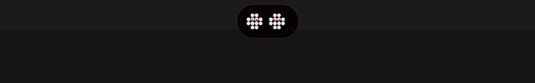
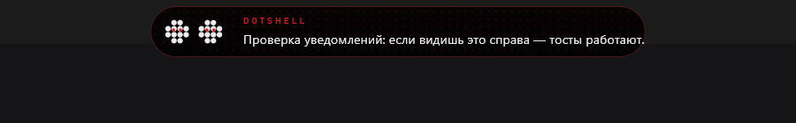
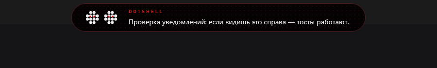
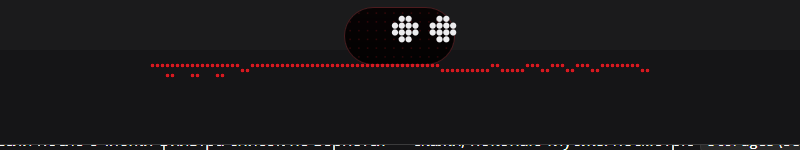
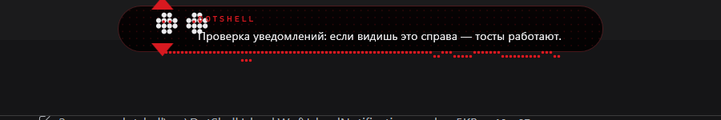
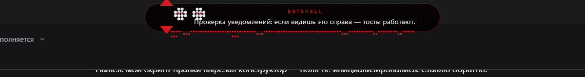
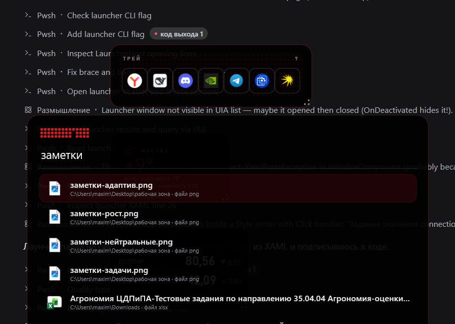
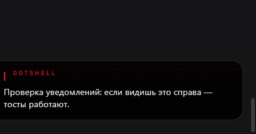
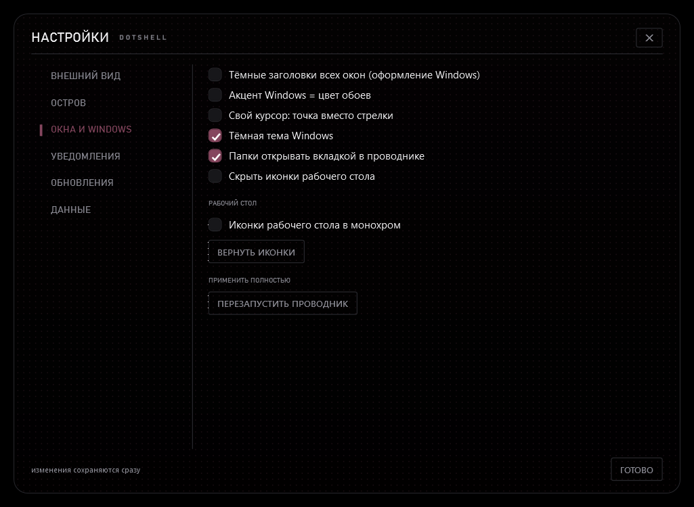
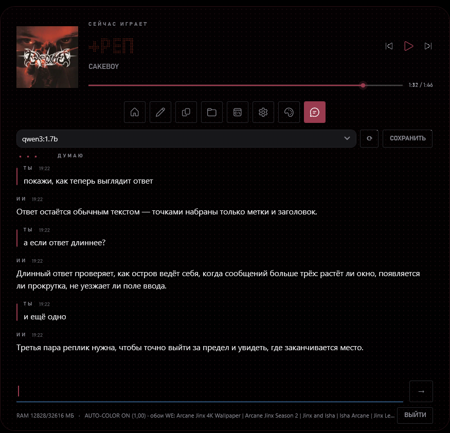

# История версий

Здесь коротко: что изменилось в каждой версии и что это значит для человека.
Подробные описания с картинками — на [странице релизов](../../releases).

---

## 0.88.0 — поиск по настройкам

В настройках 76 полей в шести категориях. Без поиска вопрос «где порог „не мешать“»
превращался в игру в прятки.

### Как работает

- поле поиска в шапке окна;
- ищет по всей настройке: собственный текст элемента, подпись над ним, тултип;
- находит совпадения **во всех категориях**, сам переключается на ту, где их больше,
  и подсвечивает её в навигации;
- под навигацией пишет итог: «найдено 2 · ОСТРОВ» или «ничего не нашлось: „…“»;
- очистка поля возвращает обычный вид.

### Как сделано

Фильтрация рекурсивная: подпись раздела запоминается как «название» следующей строки,
строки без совпадений прячутся, контейнер остаётся видимым только если внутри что-то
нашлось. Без рекурсии фильтровался верхний уровень, и вложенные поля оставались.

Проверено через UI Automation: ввод «порог» → «найдено 1 · ОСТРОВ», открыт нужный пункт.

### Известные ограничения

- часть соседних строк в контейнере может остаться видимой (фильтрация контейнеров
  неполная);
- подпись «найдено N» считает настройки, а не все видимые строки.

---

## 0.87.0 — обзор: медиа и погода вместо пустоты

В панели-обзоре нижняя половина была пустой: часы, метрики и календарь сверху, а под ними
~200 px черноты. Панель выглядела недоделанной.

### Что появилось

Нижняя полоса в две колонки, тем же языком (номер раздела, волосяная линия, крупное число):

- **01 · МЕДИА** — текущий трек и исполнитель; если ничего не играет, так и написано;
- **02 · ПОГОДА** — температура крупно, город и состояние рядом.

### Попутно

- панель теперь открывается **ниже острова** (`Top = WorkArea.Top + 68`): раньше раскрытая
  капсула висела поверх шапки обзора и перекрывала вкладки;
- высота окна 620 → **560**: пустоты внизу стало меньше;
- выбранный день календаря — штамп с радиусом 2 (сделано в 0.86.0, здесь видно на снимке).

---

## 0.86.0 — практичность и эстетика: настройки, обзор, центр управления

Провёл ревизию интерфейса «глазами человека»: снимки реальных пикселей, а не отрисовка
окна, плюс опрос через UI Automation.

### Настройки

- **значения рядом с ползунками**: раньше «плотность рисунка» и «радиус капсулы» двигали
  вслепую — теперь под каждым ползунком стоит его число;
- **тёмный скроллбар**: системная светлая полоса справа была самым «чужим» элементом окна;
- фон под содержимым сделан непрозрачным.

### Центр управления

- высота по содержимому (было окно 520–650 px с пустотой в треть экрана);
- в шапке дата и время;
- «СПРЯТАТЬ СТОЛ» → «ИКОНКИ СТОЛА» (было непонятно, что именно прячется).

### Панель-обзор

- выбранный день в календаре — **штамп с радиусом 2**, а не «таблетка» с радиусом 14:
  скругление 14 px выбивалось из языка шелла (акцент — метка, не кнопка).

### Найденное, но не исправленное

Призрачная строка текста под первым пунктом настроек: сжатые подписи категорий
проступают в области содержимого. Проверено: это **не** навигация (скрытие навигации не
убирает артефакт), **не** полупрозрачность (непрозрачный фон под содержимым не помогает),
**не** мой код подписей (артефакт есть и без него). Нужен отдельный заход с отладкой
визуального дерева в рантайме.

---

## 0.85.0 — главная страница обрезалась при запуске «не на ту вкладку»

Владелец попросил довести до идеала всё, что есть. Начал с ряда «пустых
прямоугольников» на главной странице — оказалось, что это не кнопки, а обрезанные
верхушки плиток.

### Причина

`ExpandAndGoToTab(tag)` передавал тег в `ApplyTabSize` без проверки. Если тег
отсутствовал в `TabSizes` (например, `--tab=media` — такой вкладки нет, есть только
плеер сверху), размер окна брался **по умолчанию — 800×398** вместо домашних 975×765.
Содержимое домашней страницы выше на ~370 px, поэтому плитки обрезались: их верхние
части и выглядели как ряд пустых рамок.

### Исправление

Неизвестный тег нормализуется в `home` до `Expand()`:

```csharp
if (!TabSizes.ContainsKey(tag)) tag = "home";
```

### Проверено

Было: `--tab=media` → окно **800×398**, плитки обрезаны.
Стало: `--tab=media` → окно **975×765**, главная страница целиком: подписи кнопок,
группы программ, количество ярлыков.

Заодно подтвердилось, что подписи инструментов («СВЕТЛАЯ ТЕМА», «СПРЯТАТЬ СТОЛ»,
«ФОКУС») заполняются в `RefreshToolLabels` корректно.

---

## 0.84.0 — полировка: заголовок трека и иконки вкладок

Два визуальных дефекта, видных на каждом раскрытии острова.

### 1. Заголовок трека обрезался на середине слова

У точечного заголовка стояли жёсткие `FixedColumns = 90`. Всё, что короче или длиннее,
резалось по этой сетке: «РАЗБИВАЙ МОИ МЕЧТЫ» превращалось в «РАЗБИВАЙ М».

Теперь колонки считаются от длины строки (`DotColumnsFor`), как уже было сделано для
подписи исполнителя. Стартовое значение 24 пересчитывается при смене трека.

### 2. Иконки вкладок рисовались пустыми квадратами

В шаблоне `DsTabIcon` стоял `ContentPresenter` без прокидывания шрифта. WPF создавал
`TextBlock` с унаследованным шрифтом, и PUA-глифы вкладок (`E80F`, `E70F`, `E8C8`…)
превращались в «тофу» — квадраты вместо иконок.

Теперь `TextElement.FontFamily`, `FontSize` и `Foreground` прокидываются через
`TemplateBinding`. Проверено снимком: вкладки показывают дом, карандаш, буфер, папку,
терминал, шестерёнку, тему и чат.

---

## 0.83.0 — адаптивность: настройки, аудио, трей

Последние виджеты из списка «размер решает композицию».

| Виджет | Полоска | Маленький | Нормальный | Большой |
|---|---|---|---|---|
| **настройки** | только поле поиска | поиск + подсказка | + список результатов | + список |
| **аудио-роутер** | приложения | приложения | + колонка устройств | + колонка устройств |
| **трей** | только значки | + шапка «ТРЕЙ» и счётчик | + шапка | + шапка |

Курсы валют уже были адаптивны: на низком размере скрываются период, подпись, подсказка и
спарклайны, остаются цифры и дельты.

Проверено снимком: трей в полоске показывает ряд значков без шапки — шапка в 46 px
съедала половину высоты.

Итог по теме: **все виджеты адаптивны**.

---

## 0.82.0 — последние два дефекта ревизии

### 1. Смена темы копила таймеры виджета

`WidgetWindow.Reload()` пересобирал содержимое через `_root.Child = BuildContent(...)` и
ничего не останавливал: таймеры старого тела продолжали тикать по мёртвым элементам,
`media.PropertyChanged` получал новый обработчик поверх старого, а подложка острова
терялась — при каждой смене темы/рисунка/города виджет грузил систему сильнее.

Теперь `Reload` останавливает и чистит таймеры, снимает обе подписки, сбрасывает `_relayout`
и пересобирается через `SetContent(_type)` — с подложкой. `SetContent` заодно сбрасывает
правило композиции: новый состав не должен наследовать чужой `_relayout`.

### 2. Раскрытие на нижней кромке уезжало под панель задач

`AnimateShellTo` анимировал `Width/Height/Left`, но не `Top`. На нижней кромке окно растёт
вверх, поэтому раскрытый остров целиком уходил под панель задач — виден был только
свёрнутый.

Теперь при `IslandEdge = bottom` в той же анимации `Top` уезжает вверх:
`work.Bottom - winH - offset`.

Проверено на живой сборке: свёрнут `550×128 @ y=1240..1368`, после клика
`975×398 @ y=970..1368` — низ остался на кромке, остров вырос вверх.

---

## 0.81.0 — ревизия: семь дефектов, найденных аудитом

Провёл ревизию кода острова и виджетов. Нашёл и исправил:

### 1. Окно переставало расти после первой анимации

В `AnimateTo` ветка для `Window` не снимала анимацию по завершении (снималась только для
`UIElement`). Замороженное значение продолжало переопределять `Width/Height/Left`, и прямые
присваивания игнорировались: длинный чат растягивал капсулу, а окно оставалось прежней
высоты (обрезался хвост и поле ввода), длинные уведомления обрезались, «Показать остров» не
возвращал остров по горизонтали.

### 2. Остров нельзя было держать на втором мониторе

`ClampToScreen` (остров и виджеты) клампил по `SystemParameters.WorkArea` — основному
монитору. После отпускания мыши окно утаскивало назад, на основной экран. Теперь кламп по
виртуальному экрану.

### 3. Плитки групп копились

`RebuildPinnedTiles` не очищал `_groupDots`: каждая перестройка добавляла записи, тик раз в
секунду опрашивал процессы по удалённым группам, старые плитки не освобождались.

### 4. Виджеты грели диск и Windows Update

«Светофор обновлений» опрашивал систему каждые **60 мс** (16 раз в секунду), «зашлакованность»
сканировала диск каждые **300 мс**. Теперь — раз в минуту и раз в пять минут.

### 5. Уведомление ломало раскрытый остров

Если уведомление висело, а остров раскрыли, таймер уведомления сжимал капсулу до свёрнутой,
оставляя `_isExpanded = true`: содержимое обрезалось, а следующий клик сворачивал вместо
раскрытия. Теперь при раскрытом острове убирается только слой уведомления.

### 6. Меню второй валюты ничего не делало

Колбэк был пустой (`() => { }`) — выбор валюты не менял цифры до пересоздания виджета. Теперь
вызывается `Reload`.

### 7. Сообщения статуса жили меньше секунды

Тик раз в секунду безусловно перетирал `StatusLine` телеметрией, поэтому «не удалось
запустить», «это не программа — нужен ярлык», «таймер: впиши минуты числом» исчезали
мгновенно. Теперь у статуса 3 секунды защиты.

Плюс: в тихом режиме наведение на полоску теперь действительно вытаскивает остров
(`Pill.MouseEnter` был ни к чему не привязан).

---

## 0.80.0 — два дефекта состояния острова

Ревизия кода острова, найдено и исправлено.

### 1. Автоскрытие подписывалось заново на каждом раскрытии

В `Expand()` стояло `_autoHideTimer.Tick += ...` — каждая раскрытие добавляло ещё один
обработчик. При автоскрытии через 30 секунд таймер срабатывал столько раз, сколько раз
остров раскрывали, а старые обработчики держали окно живым.

Теперь обработчик подписывается один раз в `CreateAutoHideTimer()`, а `Expand` только
запускает таймер.

### 2. Выход из «не мешать» терял настройки геометрии

`ExitQuiet()` возвращал жёстко зашитые радиус 23 и высоту 46. Если в настройках стоял
радиус 4, после выхода из тихого режима остров прыгал на 23 и переставал соответствовать
своим же настройкам.

Теперь `ExitQuiet()` вызывает `ApplyCapsuleGeometry()`, а тихий режим берёт
`min(islandRadius, 3)` вместо константы.

---

## 0.79.0 — сквозной аудит: два дефекта в виджетах

Прогнал все точки входа, которые есть в программе: **20 запусков** (настройки, поиск,
витрина, клавиши, обзор, центр управления, док, обе витрины стилей, вкладки, восемь
виджетов). Итог: процессов **20 из 20 живых**, окон **20 из 20 появились**, `FATAL`
**ноль**.

Аудит выявил два дефекта, оба про виджеты:

### 1. Виджеты копились

Каждый запуск с флагом `--widget=` добавлял запись в `widgets.json`, а убирать их можно было
только по одному правым кликом. За прогон накопилось **девять**.

Исправлено: `WidgetsManager.CloseAll()` + `WidgetStore.Clear()` + пункт трея
**«Убрать все виджеты»** — закрывает окна и чистит сохранённый состав.

### 2. Размер виджета не сохранялся

В `widgets.json` у всех записей было `W: 0, H: 0` — размер, заданный флагом или ручкой,
не попадал в хранилище, и следующий запуск открывал виджет «по содержимому».

Исправлено: после установки размера вызывается `OnResized`. Проверено:
`"W": 520, "H": 112`, после перезапуска — ровно один виджет, а не девять.

---

## 0.78.0 — эквалайзер-виджет: режим полоски

Эквалайзер тянулся по ширине, но на низком виджете «сталактиты» превращались в мусор из
точек: минимальная высота 36 px не оставляла места самим полосам.

Теперь два режима по классу размера: полоска — высота 10 px и узкие поля, остальное —
как было. Проверено сборкой и запуском.

Осталось из этой темы: курсы валют, настройки, аудио-роутер, трей.

---

## 0.77.0 — адаптивность виджетов-панелей (первая половина)

Продолжение правила «размер решает композицию» для виджетов со списками.

### Что стало адаптивным

| Виджет | Полоска | Маленький | Нормальный | Большой |
|---|---|---|---|---|
| **зашлакованность** | только цифра | цифра + описание | + кнопки и статус | + разбивка по зонам |
| **дубликаты** | только статус | + выбор папки | список | список |
| **карта окон** | список | список | список + превью | список + превью |

Для списков «композиция» и есть «сводка против списка»: на полоске человеку нужен
ответ, а не таблица.

### Что осталось

Курсы валют (сложная структура: блоки со спарклайнами), настройки (поиск + список),
аудио-роутер (две колонки), трей (значки + имена), эквалайзер (уже тянется, но без
режима полоски). Это следующая пачка.

---

## 0.76.0 — виджеты на обоях

Последний пункт из механики Linux-видео: виджеты живут не «поверх всего», а на рабочем
столе, под окнами.

### Как работает

`desktopWidgets`: окно виджета получает `WS_EX_NOACTIVATE` и уходит на дно z-порядка
(`HWND_BOTTOM`), а раз в 2 секунды возвращается туда же — иначе всплывает после кликов.

### Почему не WorkerW

Трюк живых обоев (пере-родительство в `WorkerW`) ломает ввод и перетаскивание, а виджеты
должны оставаться живыми. `HWND_BOTTOM` даёт тот же визуальный результат, переживает
перезапуск проводника и не мешает мыши.

### Как включить

Настройки → «Виджеты на обоях (под окнами)» или трей → «Виджеты на обоях». Режим
применяется к виджетам, открытым после переключения.

Проверено: у окна виджета выставлен `WS_EX_NOACTIVATE`, окно создаётся и позиционируется.

---

## 0.75.0 — док слева

Из механики Linux-видео: вертикальная полоса с закреплёнными программами у левой кромки.


### Что умеет

- берёт **закреплённые программы** из тех же групп, что виджеты и лаунчер;
- показывает настоящие иконки программ (через наш `IconCache`, а не иконку ярлыка);
- под каждой иконкой — **точка 5×5**: акцентная, если программа запущена (проверка раз
  в 3 секунды), серая — если нет;
- клик запускает программу, наведение подсвечивает плитку;
- стоит по центру левой кромки, окно не в Alt+Tab.

### Как включить

Трей → «Док слева», флаг `--dock`, или настройка `dockEnabled` (док вернётся при
следующем запуске).

### Ограничения

- список — до 12 программ;
- у ярлыков, ведущих в Microsoft Store, остаётся системная иконка с оверлеем-стрелкой:
  у них нет обычного exe, откуда можно вытащить значок.

---

## 0.74.0 — кромки и центр управления

Два пункта: последний из списка 25 и первый из механики Linux-видео.

### Кромки

`islandEdge`: верхняя или нижняя. Остров прижимается к выбранной кромке, растёт в нужную
сторону, а при изменении размера пересчитывает `Top` от низа рабочей области (для нижней
кромки). Боковые кромки не делал: вертикальная капсула — это переделка раскладки, а не
настройка; в плане отмечено отдельно.

### Центр управления

Отдельное окно, выезжает справа (`--control-center` или трей → «Центр управления»):

- **громкость** — настоящая системная (WASAPI), ползунок на `DotSeekBar` текущего стиля;
- **быстрые переключатели**: тёмные заголовки окон, спрятать иконки стола, «не мешать», звук;
- **питание**: заблокировать, сон, настройки, выйти.

Переключатели рисуются акцентной рамкой при включении; окно закрывается по Esc и по
потере фокуса.

### Итог по 25 пунктам кастомизации

**25 из 25** — кромки были последним (в формате верх/низ).

---

## 0.73.0 — кастомизация: фокус акцента, второй акцент, состав обзора

Последние пункты из списка 25, кроме кромок.

### Где живёт акцент

`accentFocus`: «везде» / «только часы и трек» / «только плеер» / «приглушённый везде».
Реализовано через яркость второстепенных акцентных элементов (чипы, рамки, фон):
в узких режимах они гаснут, а основной акцент остаётся.

### Второй акцент

`accentSecondHex`: если задан цвет, **прогресс и ползунки** берут его вместо основного.
Пресеты в настройках: синий, зелёный, фиолетовый, янтарный.

### Состав панели-обзора

`dashboardTabs`: какие вкладки показывать и в каком порядке. Пресеты: все четыре,
обзор+медиа, обзор+погода, медиа+производительность, производительность+погода.

---

## 0.72.0 — кастомизация, пачка 3: поведение и переходы

Третья пачка 25 пунктов.

| Настройка | Что делает | Значения |
|---|---|---|
| `tabTransition` | переход между вкладками | растворение / сдвиг / шторка / без анимации |
| `clickAction` | клик по капсуле | раскрыть / поиск / обзор |
| `autoHide` | автоскрытие | никогда / через 30 с |
| `quietThreshold` | порог режима «не мешать» | только развёрнутые / любое крупное окно / выкл |
| `widgetGrid` | прилипание виджетов | 0 (выкл) / 8 / 16 px |
| `coverShape` | форма обложки | квадрат / скругление / круг |

Дополнительно: у `ForegroundProbe` появился `IsForegroundCovering()` — мягкий порог
«любое крупное окно» (больше 70 % рабочей области), в отличие от строгого «развёрнуто».

Проверено: настройки открываются, в окне восемь комбобоксов, FATAL в логе нет.

### Итог по 25 пунктам

Готово **21 из 25**. Осталось:

- `accentFocus` («где живёт акцент») — требует переписать цветовые привязки элементов;
- второй акцент — то же самое;
- кромки (лево/право/низ) — переписывать позиционирование;
- состав дашборда — выбор и порядок вкладок.

---

## 0.71.1 — кастомизация, пачка 2: акцент, точки, уведомления

Вторая пачка из 25 пунктов.

### Акцент

- `accentTemperature` (−30…+30): сдвиг оттенка акцента — теплее или холоднее;
- `accentSaturation` (0–100): насыщенность, вплоть до почти серого.

Обе настройки считаются в HSV внутри `ColorPalette.ApplyTint`, поэтому яркость не портится.

### Точки

- `dotTextDensity` (5–7): сколько точек приходится на глиф в точечном тексте —
  множитель обратный: 5 — крупнее ячейка, 7 — мельче и плотнее;
- `dotLiveliness` (off / rare / bass): живость точечных часов — статика, редкое мерцание
  или дыхание с басом.

### Уведомления

- `notifyMode`: капсула / карточка в углу / системный тост / только точка (тихо);
- `notifySeconds` (3–10): сколько висит;
- `notifySound`: без звука / короткий тик / системный.

Всё в настройках, в разделе внешнего вида и уведомлений; применяется сразу.

**Чего сознательно не сделал:** `accentFocus` («где живёт акцент») — требует
переписывания цветовых привязок во всех элементах, а не только настройки. Пункт переношу
в пачку 3.

---

## 0.71.0 — кастомизация, пачка 1: форма и движение

Владелец попросил делать по максимуму без ожидания одобрения. Это первая пачка из 25
пунктов кастомизации — та, что видна сразу.

### Что появилось в настройках (ВНЕШНИЙ ВИД)

| Настройка | Что меняет | Диапазон |
|---|---|---|
| `islandRadius` | радиус капсулы: прямоугольник ↔ таблетка | 0–24 |
| `collapsedHeight` | высота свёрнутой капсулы | 36–64 |
| `islandTopOffset` | отступ от верхней кромки | 0–24 |
| `animationSpeed` | скорость всех анимаций острова | 0.5–2× |
| `animationCurve` | кривая движения: торможение / туда-обратно / линейно / пружина | — |
| `dotShape` | форма точки всей точечной графики: круг, квадрат, ромб, штрих | — |
| `dotStagger` | шахматный сдвиг строк в точечной сетке | вкл/выкл |

### Как сделано

- высота и скорость перестали быть `const`: теперь это свойства, читающие настройки;
- радиус и отступ применяются к капсуле сразу, радиус ограничен половиной высоты —
  иначе WPF рисует скругление с изломом;
- форма точки и шахматка живут в ядре (`DotGrid.Shape`, `DotGrid.Stagger`), их читает
  растеризатор точечного текста и часов;
- в окне настроек появились ползунки и два комбобокса (кривая, форма точки);
- изменения применяются на лету: подписка на `ThemeBus.SettingsChanged`.

### Проверено

Радиус 4 + высота 58 + отступ 4 — капсула стала прямоугольной и выше, отступ уменьшился;
радиус 8 + высота 50 + отступ 6 — другая геометрия, применяется без перезапуска.

**Осталось из 25:** пачка 2 (температура и насыщенность акцента, где живёт акцент,
плотность точечного текста, живость точек, уведомления) и пачка 3 (переходы, поведение,
виджеты). Плюс два дорогих пункта: второй акцент и кромки.

---

## 0.70.2 — бас во всех рисунках и без просвечивающих полос

Два замечания: «почему дрожат только точки, а волны/топо/лучи/аврора/сетка — нет» и
«откуда горизонтальные выцветшие полосы».

### Бас теперь у всех рисунков

Общий множитель `_liveBass` (бас × настройка) читают все стили фона:

| Рисунок | Что делает на ударе |
|---|---|
| волны | амплитуда ×(1 + 1.4·bass), линии ярче |
| топо | контур гуляет сильнее и раздувается, ярче |
| лучи | шире и ярче, как вспышка |
| аврора | пятна растут и дрейфуют быстрее |
| сетка | раздувается от центра, ярче |
| точки | размер и кольцевая дрожь (было) |

Замер по кадрам с тоном 60 Гц: волны 3.5 тыс. изменённых каналов, топо 2.3 тыс.,
лучи 2 тыс., сетка 9.4 тыс., точки 2.2 тыс., аврора 0.1–0.2 тыс. (её поднял отдельно
через дрейф и размер пятен, но она самая «мягкая» по природе).

### Откуда полосы

Это **не рисунок**: при `islandOpacity = 92` сквозь капсулу просвечивал текст окна позади —
на тёмном фоне строки читались как горизонтальные выцветшие полосы. Плюс изредка оставался
полупрозрачный «призрак» предыдущей вкладки при быстрых переключениях.

Исправлено:

- плотность фона по умолчанию **97 %** (ползунок в настройках никуда не делся);
- после переключения вкладки через 300 мс запускается страховка: всё, что не текущая
  вкладка, принудительно скрывается. Быстрые переключения больше не оставляют призраков.

---
## 0.70.1 — кнопки на главной, тихий бас, кольцо с обложкой

Три замечания владельца после 0.70.0.

### Кнопки на главной больше не «не работают»

На самом деле они срабатывали — и сразу же остров **сворачивался**. Клик по кнопке
доходил до обработчика пилюли, и тот видел «нажали не на интерактивное». Причина: смена
темы пересобирает содержимое, нажатая кнопка успевает отвалиться от дерева, и проверка
`IsInteractive` на `MouseUp` возвращает false.

Исправлено: интерактивность запоминается **на нажатии** (`MouseDown`), и `MouseUp` уже не
может «переобуться». Проверено: после клика по «ТЁМНАЯ ТЕМА» остров остаётся раскрытым
(975×765 вместо 550×128).

### Бас стал настройкой и больше не перекрывает текст

- новая настройка `bassVisualization` (0…1, по умолчанию **0.35**): 0 — фон не реагирует
  совсем, 1 — прежняя интенсивность;
- яркость рисунка ограничена 1.35 от базовой (было до 1.8), базовая прозрачность при
  высокой чувствительности наоборот снижается;
- амплитуда дрожи и размер точек умножаются на ту же настройку.

### Стили 8 и 10 объединены: кольцо с обложкой


При `seekStyle = "arc"` плеер показывает **обложку внутри кольца**: кольцо — прогресс,
толщина дуги дышит с басом (это и есть бывший стиль «пульс»), на дуге — точка-голова.
Перемотка — клик и перетаскивание по кольцу (по горизонтали, пока).

Ползунок «точки с хвостом» (вариант 14) уже доступен: `sliderStyle = "dots"`.

---
## 0.70.0 — стили ползунков и таймлайна, живые точки, таймер на своём месте

Три замечания владельца и его выбор из списка идей.

### Таймер больше не «живёт» на всех вкладках

Кросс-фейд вкладок иногда не доводил скрытие старой: `Fade` с колбэком завершения мог не
сработать, и заметки с таймером оставались поверх главной. Теперь переключение
**детерминированное**: все вкладки, кроме нужной, гасятся и прячутся сразу, а колбэк
завершения проверяет, что вкладка всё ещё неактуальна, прежде чем что-то менять.

### Точки дрожат под бас, а не «шторка»

Раньше реакция была прозрачностью — снаружи это читалось как затемнение, а не как живое
поле. Теперь у точечного поля **меняется размер точки** (`1.2 → 1.2 + bass·2.4`) и
**положение**: кольцевая волна от центра смещает точки, амплитуда до 2.2 px. У сетки
яркость и масштаб тоже поднимаются с басом.

### Стили ползунков и таймлайна (выбор владельца)

Таймлайн: **бусины (1), рельс с иголкой (2), деления ресивера (4), волна (5), пески (7),
дуга (8), пульс под бас (10), кассета (11)**.

Ползунки: **капсула (12), блоки (13), точки с хвостом (14)**.

Всё живёт в одном контроле `DotSeekBar` — одиннадцать рендереров, переключение через
свойство `Variant`. Настройки: `seekStyle` (таймлайн) и `sliderStyle` (ползунки).

**Витрина:** `DotShell.exe --slider-demo` — окно со всеми одиннадцатью вариантами сразу,
чтобы выбирать глазами.

Механика перемотки остаётся рабочей во всех стилях: клик и перетаскивание, перемотка
один раз на отпускании, под курсором время. Для дуги перемотка пока по горизонтали —
круговую механику сделаю отдельно, когда дойдём до плеера в виджете.

---
## 0.69.1 — прогресс, который не врёт, и тема, которая слышит бас

Три вопроса владельца: эквалайзер настоящий или картинка, почему ползунок трека не
отражает реальность, и можно ли, чтобы тема двигалась под басы.

### Эквалайзер — настоящий

Сомнение понятное: в тишине он просто стоит. Проверил тоном 80 Гц в системный вывод —
в логе `spectrum: сигнал True`, полосы ожили. Это WASAPI loopback (системный звук) и
настоящий FFT, а не имитация. В покое он честно показывает тишину — отсюда и ощущение
«просто визуализация».

### Ползунок трека

Оказалось хуже, чем «неточно»: **Dotify вообще не публикует позицию** — в SMTC всегда
`0:00`, хотя трек играет. Ползунок честно показывал то, что даёт система.

Что сделано:

- `MediaBridge.LivePosition`: храним «якорь» (позиция + момент времени) и считаем
  позицию сами — она тикает между ответами плеера;
- переякориваемся только на **изменение** того, что прислал плеер. Раньше сравнение шло
  с расчётной позицией, и «вечные нули» Dotify каждую секунду обнуляли счётчик;
- все потребители (остров, дашборд, виджет плеера) переведены на `LivePosition`.

Проверка: `live=2.0 → 2.5 → 3.0 → 3.5` при `smtc=0.0`, и на снимке честные `0:11 / 1:51`.

### Полоска перемотки

Была тонкая линия с точкой. Стала:

- прошедшая часть — **точки**, в языке острова, а не заливка;
- дорожка толще при наведении, голова крупнее и с более заметным ореолом;
- под курсором появляется **время, куда попадёшь** — перемотка перестала быть вслепую.

### Тема под басы

В `AudioSpectrum` появился `Bass` — среднее нижних полос (быстро вверх, медленно вниз,
чтобы «удар» было видно, а дрожи не было). `IslandBackdrop` умножает яркость рисунка на
`1 + bass * 0.75`: в тишине 1.0, на ударе до ~1.8. Тема остаётся темой — меняется только
её интенсивность. Обновление — 30 кадров в секунду.

---
## 0.69.0 — адаптивные виджеты: размер решает композицию

Владелец уточнил: дело было не в плеере — «я вообще про все виджеты говорил, просто
плеер как хороший пример».

**Правило.** Раньше у каждого виджета был один каркас, из которого по размеру прятались
элементы: в маленьком оставалась пара строк, в большом — пустое поле. Теперь размер
выбирает **композицию**: полоска, маленький квадрат, обычный и большой — четыре разных
ответа на вопрос «что здесь главное».

**Что уже адаптивно:**

| Виджет | Как меняется |
|---|---|
| часы | полоска — только цифры; квадрат — цифры и дата; широкий — цифры слева, месяц и день недели справа |
| система | полоска — две дорожки без подписей; обычный — подписи с процентами; большой — плюс занятая память и батарея |
| погода | полоска — знак и температура; квадрат — плюс город; обычный — плюс состояние; большой — температура слева, детали справа |
| юниты | полоска и квадрат — одно существо; обычный — два; большой — два и подпись |
| обновления Windows | полоска — лампа и статус одной строкой; карточка — объяснение, легенда и кнопки |
| плеер | полоса, карточка, обложка (0.68.1) |

**Механика.** `WidgetAdaptive`: класс размера (полоска / маленький / обычный / большой),
выбор нужной раскладки и кросс-фейд 140 мс между ними. Раскладки лежат друг на друге в
одной сетке, поэтому переключение не дёргает размер окна.

**Два бага, найденные снимками:**

- «Указанный элемент уже является логическим дочерним для другого элемента» — одни и те
  же дорожки и существо попадали в две панели сразу. Теперь у каждой раскладки свои;
- панель оставалась прозрачной: кросс-фейд запускался до загрузки окна, анимацию некому
  было отыграть, и `Opacity` застревал на нуле. До `Loaded` переключение идёт без анимации.

**Ещё не адаптивны:** курсы валют, настройки, очистка, дубликаты, карта окон,
аудио-роутер, трей и эквалайзер. Это панели со списками — им нужен свой набор состояний
(список + сводка вместо списка), и это следующий шаг.

---
## 0.68.1 — плеер по размеру и плавный остров

Две заметки владельца, сделанные по видео и скриншотам:

> «вот так я хотел, чтобы наши виджеты работали, возьми на заметку, как правильно влияет
> размер виджета на отображение информации»;
> «на видео остров — размеры, переходы вкладок, всё плавно; размер меняется плавно».

### Виджет плеера: три раскладки вместо одной

Раньше был один каркас, из которого по размеру прятались элементы: на широком низком
виджете оставались большие кнопки и пустое место. Теперь раскладка выбирается по размеру,
как у Dotify:

| Размер | Раскладка |
|---|---|
| низкий (высота < 170) | **полоса**: обложка 56 слева, название и исполнитель, кнопки справа, тонкая полоса прогресса снизу |
| высокий и широкий | **карточка**: обложка сверху во всю ширину, ниже название, исполнитель, прогресс со временем, кнопки |
| почти квадратный | **обложка**: картинка во весь виджет, градиент снизу, название и кнопки поверх |

Переключение — с кросс-фейдом на 140 мс, а не мгновенной подменой.

Попутно два бага, которые нашлись снимками: текст был **чёрным на чёрном** (стиль
`WTitle` тянет `DynamicResource`, а в окне виджета он не разрешался — теперь цвет задаётся
явно), и полоса прогресса жила в нулевой колонке, из-за чего её отступы раздували колонку
и текст уезжал от обложки.

### Остров: переходы без рывков

- смена вкладки — **кросс-фейд**: старая гаснет за 90 мс и только потом скрывается, новая
  проявляется 160 мс;
- смена размера вкладки — **окно, капсула и слой едут одним движением** (260 мс,
  EaseInOut). Раньше окно и содержимое прыгали мгновенно, а капсула догоняла их
  анимацией — на миг виднелась полоса «широкое окно с узкой капсулой»;
- раскрытие и сворачивание идут тем же путём, что и смена вкладок;
- рост вкладки заметок под содержимое тоже анимирован, а не прыгает.

Проверено замерами: ширина острова при переключении меняется постепенно
`975 → 957 → 867 → 833 → 825`, а не одним скачком.

### Dotify

Плеер **Dotify** (Tauri + WebView2) отдаёт метаданные в системный SMTC, поэтому наш остров
и виджет видят его без всякой интеграции: трек, исполнитель, обложка, перемотка. Имя
источника теперь приводится к человеческому виду (`com.dotify.app-siw` → «Dotify»).

### Новые флаги проверки

`--widget=media` и `--widget-size=520x112` — открыть виджет нужного размера при старте.
Ими и снимались все три раскладки.

---
## 0.68.0 — панель-обзор (дашборд)

Владелец показал два видео с Linux-десктопом (AGS/Astal на Hyprland) и сказал: «вот такой
механики я хочу на винде». Первый кусок этой механики — панель, которая выезжает сверху.

**Что появилось.** Отдельное окно `DashboardWindow`: выезжает из-за верхнего края по центру,
закрывается по Esc или клику мимо. Внутри четыре вкладки:

| Вкладка | Что показывает |
|---|---|
| ОБЗОР | часы крупно (Bahnschrift 86), дата, батарея, CPU, память, время сессии, календарь на месяц с акцентом на сегодня |
| МЕДИА | обложка, трек, исполнитель, альбом, перемотка ◀◀ ▶ ▶▶, позиция |
| ПРОИЗВОДИТЕЛЬНОСТЬ | CPU и память крупными цифрами и полосками |
| ПОГОДА | температура, состояние, ощущается, ветер, влажность (тот же `WeatherService`) |

Календарь свой: сетка 7×6, неделя с понедельника, дни соседних месяцев приглушены, сегодня —
акцентный круг. Никаких сторонних контролов.

**Как открыть:** трей → «Обзор», или `DotShell.exe --dashboard`.

**Что пришлось поправить по ходу:**

- окно закрывалось сразу после открытия — `Deactivated` срабатывал раньше, чем окно вообще
  получало фокус; теперь закрытие по потере фокуса включается только после `Activated`;
- вкладки не нажимались мышью: у `TextBlock` без фона попадание считается только по буквам,
  добавил прозрачный фон и отступы.

Проверено снимками: все четыре вкладки, живые данные — CPU 23%, память 43%, погода 2°C.

---
## 0.67.3 — анимация чтения наконец видна

Владелец: «анимация чтения уведомления вообще не заметна, её как будто нет».

Сначала я подумал, что дело в амплитуде: глаза ходили на 1.9 px по телу в 26 px. Увеличил
до 3.4 px, добавил покачивание корпуса и моргание — **не помогло**, кадры всё равно были
идентичны. Тогда стал мерить, а не смотреть.

**Что оказалось.** В `crash.log` лежал `FATAL System.InvalidOperationException: Visual не
подсоединён к PresentationSource` из `Units.TrackCursor()`. Юнит уведомления создавался
скрытым, его первый тик приходился на состояние «окно ещё не показано», `PointToScreen`
бросал исключение — и таймер замолкал навсегда. При этом `IsEnabled` оставался `true`,
поэтому проверка «таймер жив?» врала.

**Что сделано:**

1. `TrackCursor` выходит, если у контрола нет `PresentationSource`, и тик обёрнут в
   `try/catch` — исключение больше не убивает таймер.
2. Анимация чтения переведена на `CompositionTarget.Rendering`: идёт с частотой монитора и
   не зависит от состояния видимости и от того, был ли уже показан контрол.
3. Движение стало заметным: зрачки ходят на 3.4 px (было 1.9), корпус покачивается на
   ±0.9 px в такт чтению, моргание раз в 1.7 с.

**Проверка была попиксельной, а не «на глаз»:** пять кадров подряд с интервалом 150 мс,
сравнение области юнита — между кадрами меняется 1.3–2.9 тыс. каналов, область изменений
совпадает с глазами и корпусом. До правки разница была нулевой.

---
## 0.67.2 — буквы внутри окна

Владелец: «текст появляется раньше, чем полностью откроется окно — пусть буквы
появляются только внутри окна: сначала середина, потом всё».



**Было:** текст проявлялся отдельной анимацией прозрачности и не был связан с шириной —
капсула ещё ехала, а надпись уже стояла целиком.

**Стало:** прозрачность убрана. Текст лежит в слое уведомления и **обрезается по текущей
ширине капсулы**; обрезка центрирована, поэтому сначала проступает середина надписи, а
края доезжают вместе с окном.



### На чём пришлось повозиться

- обрезка на всём слое съедала юнита — теперь она только на тексте;
- текст фиксируется по ширине содержимого, иначе при узком слое он схлопывался в
  многоточие вместо того, чтобы проступать по краю;
- слой выровнен по левому краю капсулы: пока он центрировался как целое, юнит уезжал
  в сторону от окна.

### Установка

Распаковать архив → закрыть старый остров (трей → «Выйти») → `install.bat`
или `install-full.bat`.

---

## 0.67.1 — плавнее

Владелец: «немного помедленнее лучше сделать анимацию открытия, слишком резко».

Тайминги пересобраны:

| Шаг | Было | Стало |
|---|---|---|
| сжатие к юниту | 180 мс | **300 мс** |
| пауза перед чтением | 70 мс | **140 мс** |
| пауза после начала чтения | 120 мс | **200 мс** |
| рост под текст | 260 мс | **460 мс** |
| закрытие: текст гаснет | 140 мс | **180 мс** |
| закрытие: сжатие | 180 мс | **260 мс** |

Суммарно открытие стало **960 мс** вместо 630 — глаз успевает увидеть все три шага,
а не догадаться, что они были.

### Установка

Распаковать архив → закрыть старый остров (трей → «Выйти») → `install.bat`
или `install-full.bat`.

---

## 0.67.0 — юнит читает



Владелец: «анимация свёртывания и раскрытия клёвая, но зубы нелепые — уберём и сделаем
так, будто юнит читает твоё уведомление».

### Убрано

Треугольники-«пасть» вырезаны целиком: отдельные зубы рядом с существом выглядели
чужеродно, потому что зубы должны быть его частью.

### Сделано

Юнит реагирует сам — новый режим `Units.Reading`:

- взгляд перестаёт следить за курсором и **скользит по строке** слева направо;
- в конце строки короткий возврат влево и снова вправо — как человек, перечитывающий
  уведомление;
- лёгкий наклон вниз (0.32) — будто смотрит на текст, а не в стену;
- после закрытия режим выключается, и юнит снова следит за мышью.

Анимация капсулы осталась прежней: сжатие к юниту (84 px) → чтение и рост капсулы под
текст → через 6 с обратный ход.

### Установка

Распаковать архив → закрыть старый остров (трей → «Выйти») → `install.bat`
или `install-full.bat`.

---

## 0.66.0 — уведомление из юнита

Владелец: «пусть остров сворачивается к юниту, тот плавно уходит в центр и оттуда
открывается уведомление — сейчас зубки двигаются, а юнит стоит, и это выглядит тупо,
потому что зубы должны быть его».

Так и сделано: показ теперь **три шага**, а не один кадр.



1. **сжатие** — капсула анимируется до 84 px, внутри остаётся только юнит;
2. **пасть** — вокруг юнита раскрываются зубки: верхний вверх, нижний вниз, выходя за
   края капсулы;
3. **текст** — подпись и сообщение проявляются, капсула разрастается под них (до 1100 px).



Закрытие — обратный ход: текст гаснет → пасть закрывается → капсула сжимается к юниту →
возвращается обычное содержимое и прежняя ширина.

### Что пришлось поменять внутри

`IslandNotification` переделан из «покажи всё сразу» в набор шагов: `Prepare`,
`OpenMouth`, `ShowText`, `CloseMouth`, `Hide`. Последовательностью управляет остров —
иначе анимации накладывались друг на друга.

Отдельная тонкость: пока текст не показан, он **убирается из раскладки**. Раньше он был
невидимым, но занимал ширину, и юнит стоял слева от центра вместо центра капсулы.

### Проверка

Кадры: сжатая капсула с юнитом, раскрытая пасть с зубками за пределами капсулы,
финальный кадр с текстом. После закрытия остров возвращается на место (`550x128` по центру).

### Установка

Распаковать архив → закрыть старый остров (трей → «Выйти») → `install.bat`
или `install-full.bat`.

---

## 0.65.0 — уведомления в острове



Вместо карточки в углу уведомление теперь появляется в самой капсуле: юнит
«раскрывает пасть», зубки расходятся и выходят за края острова, текст ложится между ними.

### Как это работает

1. ширина текста считается через `FormattedText`;
2. окно сразу расширяется под неё (оно прозрачное — лишнее не видно), а **капсула
   анимируется** до нужной ширины, чтобы текст не дёргался;
3. зубки разъезжаются: верхний вверх, нижний вниз — слой лежит **над** пилюлей, поэтому
   её `ClipToBounds` их не режет;
4. через 5.5 с пасть закрывается, капсула возвращается к 440 и прежнему содержимому.

Если текст короче капсулы — ничего не сужается, текст просто центрируется.

### Пойманные баги

- Мой же скрипт правки **вырезал конструктор** `IslandNotification` — все поля XAML были
  `null`, отсюда `NullReferenceException`. Теперь ошибка в `ShowNotification` ещё и
  возвращает капсулу как была, не оставляя пустую растянутую полосу.
- После показа остров уезжал вправо (`550x128 в 2096` вместо `1445`): ручное
  восстановление `Left`/`Width` неверно считало позицию. Возврат идёт штатным
  `ResizeWindowTo` — проверено, остров встаёт по центру.

### Осталось

Анимация «юнит тащит остров из-за края», когда капсула утоплена: сейчас в этом случае
уведомление показывает карточка в углу.

### Установка

Распаковать архив → закрыть старый остров (трей → «Выйти») → `install.bat`
или `install-full.bat`.

---

## 0.64.0 — трей на Win32

Третья попытка снять WinForms — и первая удачная. Две предыдущие провалились на меню:
WPF-попап (`ContextMenu`) с `Shell_NotifyIcon` **не держится**, потому что у скрытого
окна трея нет нормальной активации. Проверял дважды: message-only окно и настоящее
скрытое с `WS_EX_TOOLWINDOW` — оба раза меню закрывалось само.

### Что помогло

Перестать бороться за фокус. Меню теперь — **своё окно** (`TrayMenu`): обычное
topmost-окно без рамки со списком пунктов, закрывается по потере активации и Esc.
Ему не нужен ни владелец, ни фокус.

Внутри трея — прямой Win32: `Shell_NotifyIcon`, скрытое окно-приёмник, `TaskbarCreated`
(иконка возвращается после перезапуска проводника), пузырь через `NIF_INFO`.

### Что убрано из кода

- `UseWindowsForms`;
- `DarkMenu.cs`;
- диалог выбора папки → штатный `Microsoft.Win32.OpenFolderDialog`;
- метапакет `NAudio` → `NAudio.Core` + `NAudio.Wasapi` (метапакет тянул `NAudio.WinForms`).

Звук после замены проверен: `сигнал True` на проигранный звук.

### Про вес — честно

Ожидал **−21 МБ**, но размер **не изменился** (69.89 МБ). Причина: self-contained
публикация кладёт весь runtime-пак `Microsoft.WindowsDesktop.App`, а WinForms лежит в
нём независимо от того, используем мы его или нет. Убрать их можно только вместе с WPF.

Выигрыш здесь не в мегабайтах, а в коде: нет чужого фреймворка, нет псевдонимов типов,
трей не зависит от WinForms.

### Проверка

Иконка регистрируется, меню открывается и **держится** (снимок через 4 секунды после
открытия), пункты на месте: раскрыть/свернуть, сброс позиции, папка настроек, витрина
виджетов, клавиши, проверка обновлений, выйти.

### Установка

Распаковать архив → закрыть старый остров (трей → «Выйти») → `install.bat`
или `install-full.bat`.

---

## 0.63.0 — поиск файлов



Пункт 1.4 плана. Лаунчер искал только программы: набрав имя файла, человек не находил
ничего — «Spotlight» получался наполовину.

### Что добавлено

`FileIndex`: рабочий стол, Документы, Загрузки, два уровня вложенности, до 6000 записей.
Обход всего диска сознательно не делается — минуты работы ради редкого случая.

| Совпадение | Вес |
|---|---|
| имя начинается с запроса | 300 |
| запрос внутри имени | 200 |
| нечётко, буквы по порядку | 100 |

При равном весе выше тот, что менялся позже.

В результатах **программы первыми, файлы следом**: сначала то, что запускают, потом то,
что открывают. Подпись под файлом — папка и тип.

### Найденный по пути баг

Лаунчер **вообще не открывался**: `XamlParseException` на `Click="OnPinToIsland"` внутри
`Style.Setter`. Обработчик переехал в код (`AddHandler`), теперь окно открывается.

### Проверка

Индекс **1612 файлов**; запрос «заметки» → 6 файлов, первым `заметки-адаптив.png`;
в логе `launcher: запрос «заметки» → 0 программ, 6 файлов`.

### Установка

Распаковать архив → закрыть старый остров (трей → «Выйти») → `install.bat`
или `install-full.bat`.

---

## 0.62.0 — уведомления



Пункт 1.3 плана. До этого напоминания шли системными тостами Windows: свой шрифт, свои
скругления, свой цвет — рядом с островом они выглядели чужими.

### Что теперь

Своя карточка в правом нижнем углу: тёмная, с акцентной чертой слева, точечной
микро-подписью сверху и рисунком острова на фоне.

Решения, которые принимались осознанно:

| Решение | Почему |
|---|---|
| **не забирает фокус** (`ShowActivated=false`, топмаст) | можно продолжать печатать |
| **стопка максимум из трёх** | очередь длиннее превращается в заслонку экрана |
| **живёт 6 секунд**, потом гаснет | успевает прочитаться, но не мозолит |
| **клик закрывает и вызывает действие** | «открыть» вместо «закрыть и искать» |
| **пересчёт позиции** после закрытия | карточки не оставляют дыр в стопке |

### Запасной путь

Системный тост остался: если хаб выключить, `Toast.Show` уйдёт в Windows. Галочка
«Уведомления Windows (тосты)» по-прежнему выключает уведомления целиком — теперь она
проверяется первой.

### Установка

Распаковать архив → закрыть старый остров (трей → «Выйти») → `install.bat`
или `install-full.bat`.

---

## 0.61.0 — процессы

Первый шаг большого плана: лаунчер перестаёт быть списком путей и начинает понимать,
что на машине происходит.

### Индикатор под иконкой

Было одно состояние — «запущено» (точка). Стало два:

- **точка 5×5** — программа запущена;
- **полоска 16×3** — её окно сейчас на переднем плане.

Это то, чего не хватало: видно не только «где-то живёт», но и «куда переключиться
одним кликом».

### Как определяется активное окно

`ProcessProbe.ForegroundTarget()`: `GetForegroundWindow` → pid → `MainModule.FileName`,
затем путь сравнивается с целью ярлыка. Защищённые процессы и системные окна просто не
дают ответа — это норма, индикатор остаётся точкой.

**Проверено:** передним планом был DeepSeek Harness — `IsForeground` вернул `True` для
его пути и `False` для `notepad.exe`.

Обновление раз в 3 секунды: `MainModule` у чужих процессов не бесплатный, чаще незачем.

### Установка

Распаковать архив → закрыть старый остров (трей → «Выйти») → `install.bat`
или `install-full.bat`.

---

## 0.60.0 — smoke и вес

Пункт 6 плана. Важен перед переходом к десктопу: правки пора проверять машиной, а не
глазами.

### Smoke-тест

`scripts/smoke.ps1` + флаг `--selftest` в приложении.

Скрипт:
1. сверяет версию из `Directory.Build.props` с той, что сообщает сам exe (`--version-probe`);
2. собирает проект;
3. гоняет самопроверку;
4. ищет в логе `FATAL`, появившиеся **после** запуска;
5. возвращает код 0/1 — годится для CI.

Самопроверка проверяет версию, доступ к папке настроек, цвет акцента, перечисление
мониторов, чтение ярлыков рабочего стола, версию для апдейтера. Ничего не меняет.

Отчёт пишется в **UTF-8 файл** (`--selftest=<путь>`): консоль Windows при перенаправлении
отдаёт OEM-кодировку, и русский текст превращается в кашу. Проверено и обойдено.

```
== версия в проекте        ok  в Directory.Build.props: 0.60.0
== сборка                  ok  сборка чистая
== проба версии            ok  exe отвечает 0.60.0
== самопроверка            ok  версия / настройки / акцент / мониторы / иконки / апдейтер
== лог после запуска       ok  FATAL нет
SMOKE PASS
```

### Вес

Разобрал публикацию по частям:

| Что | Размер |
|---|---|
| `Microsoft.Windows.SDK.NET.dll` (WinRT-проекции) | 24.9 МБ |
| `PresentationFramework` + `PresentationCore` | 23.6 МБ |
| **WinForms** (`Forms` + `.Primitives` + `.Design`) | **21.1 МБ** |
| `System.Private.CoreLib` | 12.6 МБ |
| 13 языковых папок ресурсов | ~15 МБ |

Убрано: `<SatelliteResourceLanguages>en</SatelliteResourceLanguages>`. Интерфейс у нас
свой, платформенные переводы не нужны.

| | было | стало |
|---|---|---|
| exe | 75.41 МБ | **69.89 МБ** (−7.3%) |
| zip | 69.7 МБ | **64.3 МБ** |

Заодно `ForegroundProbe` больше не тянет WinForms ради `Screen`: свой `Monitors`
(`EnumDisplayMonitors` + `GetMonitorInfo`). WinForms пока остаётся ради трея и диалога
выбора папки — это следующая цель (−21 МБ), но она требует переписать трей на
`Shell_NotifyIcon`.

Инвариантную глобализацию пробовал — размер не изменился, отказался (риск без выгоды).

### Установка

Распаковать архив → закрыть старый остров (трей → «Выйти») → `install.bat`
или `install-full.bat`.

---

## 0.59.0 — иконки стола



Пункт 5 плана. До сих пор шелл перекрашивал окна, курсоры и акцент Windows, а рабочий
стол оставался разноцветной свалкой.

### Как это сделано

У каждого ярлыка (.lnk) есть поле `IconLocation` — строка вида `C:\...\app.exe,0`.

1. шелл вытаскивает настоящую иконку ярлыка через `PrivateExtractIcons` (256 px);
2. считает яркость каждого пикселя с поправкой на альфу и подъёмом контраста —
   без подъёма полупрозрачные края иконки исчезают;
3. заливает силуэт **цветом акцента**: альфа = яркость, цвет = акцент. Форма остаётся,
   цвет — один;
4. пишет `.ico` с четырьмя слоями (256/48/32/16): один слой мылится в «Мелких значках»;
5. подменяет `IconLocation` на свой файл, а оригинал запоминает в `originals.json`.

### Обратимость

Кнопка «Вернуть иконки» возвращает прежние `IconLocation` и удаляет карту. Сами ярлыки
не меняются: цель, аргументы, рабочая папка — на месте, меняется только картинка.

### Проверка

Два тестовых ярлыка во временной папке:

| Операция | Результат |
|---|---|
| перекраска | `done=2 total=2 failed=0` |
| откат | `restored=2`, `IconLocation` вернулся на `notepad.exe,0` |
| оттенок | 100% непрозрачных пикселей совпали с акцентом |
| иконка из dll (`imageres.dll,3`) | `done=1`, откат вернул индекс |

### Приватность

Вместе с релизом удалён осиротевший `images/notes-tasks.png`: на него ничего не
ссылалось, но само имя отсылало к старым личным снимкам.

### Установка

Распаковать архив → закрыть старый остров (трей → «Выйти») → `install.bat`
или `install-full.bat`.

---

## 0.58.0 — чат текстом



Вернул как было.

### Убрано

- точечный заголовок `DOTSHELL CHAT` — чат снова начинается с выбора модели;
- точечные ответы — `DotParagraph` **удалён из проекта целиком**, а не выключен
  галочкой: мёртвый код, который никто не включает, — лишний вес;
- галочка «Ответы ИИ набирать точками» из настроек, поле `AiAnswersInDots` из
  конфигурации, свойство из модели.

### Осталось

- индикатор работы: точки-полоска и подпись `ДУМАЮ` — это не точечный текст;
- потолок роста чата 62% рабочей области и прокрутка в конец (0.57) — это про
  поведение окна, а не про вкус.

### Вывод

Точечный текст годится для крупных цифр и коротких акцентов. Абзац им читать неудобно
даже при разборчивом кегле — и это важнее, чем «технически работает».

### Установка

Распаковать архив → закрыть старый остров (трей → «Выйти») → `install.bat`
или `install-full.bat`.

---

## 0.57.0 — чат: потолок роста окна

Капсула больше не растягивается на весь экран при длинной переписке: рост ограничен
**62% рабочей области**, дальше работает прокрутка. Точечный ответ стал компактнее
(кегль 28 вместо 32), у списка появился нижний отступ, чат открывается прокрученным
в конец.

Замер: было 1368 px, стало 871 px при рабочей области 1380.

---

## 0.56.0 — ответ ИИ точками

Свой рендер абзаца — `DotParagraph`: переносы по словам, своя сетка на строку,
`DotGrid.Sample`/`Rasterize` как у часов. Геометрия решает: точке нужен шаг ≥ 2 px,
букве 5–6 ячеек, поэтому кегль 20 давал кашу, а 32 — читаемый текст.
Переключатель «Ответы ИИ набирать точками» в настройках.

---

## 0.55.0 — точечные акценты в чате

Заголовок `DOTSHELL CHAT` точками (длинная строка даёт достаточно колонок, чтобы
буквы читались), индикатор работы — точки-полоска и подпись `ДУМАЮ`. Подписи авторов
остались текстом: при 4–5 колонках точки превращаются в кашу.

---

## 0.54.0 — скин командной строки

Последняя вкладка, жившая системным видом: заголовок `ТЕРМИНАЛ` точечной подписью,
ввод отделён волосяной линией, вывод с `LineHeight`, приглашение `❯` — единственная
акцентная точка вкладки.

---

## 0.53.0 — тема в настройках и виджетах

`IslandBackdrop` (сетка точек, волны, топо, лучи, аврора) перестал быть достоянием
одной капсулы: рисунок появился в окне настроек и в виджетах. Смена рисунка или
плотности обновляет остров, настройки и виджеты сразу.

---

## 0.52.0 — скины вкладок: буфер и полка

Заголовки с точечными подписями, строки списков получили волосяную линию вместо
скруглённых карточек, тип записи — буквой акцентом, возраст — точечной микро-подписью,
выделение строки — акцентной чертой слева.

---

## 0.51.0 — эквалайзер и устройство вывода

Полоска в режиме «не мешать» стала эквалайзером: длина и яркость идут от спектра.
Появился выбор устройства вывода в настройках — WASAPI-loopback снимает одно
устройство, и если музыка играет на другом, захват видел нули.

---

## 0.50.0 — настройки отдельным окном

Вкладка СИСТЕМА стала входом в окно. Шесть категорий: внешний вид, остров, окна и
Windows, уведомления, обновления, данные. Новые настройки: запуск свёрнутым, интервал
проверки обновлений, Фаренгейты, включение тостов, фильтр служебных значков.

---

## 0.49.0 — режим «не мешать»

Когда на переднем плане чужое развёрнутое окно, остров сжимается в полоску 260×5 с
акцентной линией и разворачивается по наведению. Проверка — по геометрии, а не по
`WS_MAXIMIZE`: многие приложения рисуют «развёрнуто» без этого стиля.

---

## 0.48.0 — обновление в один клик и перезапуск проводника

Пункт 3 плана целиком.

**Перезапуск проводника.** В меню трея острова появился пункт «Перезапустить
проводник». Он нужен потому, что часть оформления Windows (подсветка «Пуска», цвета
оболочки) применяется только при старте `explorer.exe` — без этого человек видит
«половину» изменений и решает, что они не сработали. Проверено: процессов explorer
было 2, после перезапуска 1, панель задач вернулась.

**Самообновление.** Кнопка **ОБНОВИТЬ САМ** в окне обновления:

1. скачивает `DotShell.exe` из релиза с прогрессом;
2. **проверяет** файл: запускает его с `--version-probe` и сверяет версию — не
   совпало, файл удаляется;
3. при перезапуске подменяет себя: текущий exe переименовывается в `.old`,
   новый встаёт на его место, старый процесс выходит;
4. `.old` удаляется только после успешного старта новой копии — это точка отката.

Проверено полным циклом: `--self-update-test` копирует себя, прогоняет
переименование/копирование/перезапуск — в логе `заменил exe, запускаю новую копию`,
затем `удалил .old`, остался один живой процесс.

---
## 0.47.0 — меню виджетов открывается

Владелец: «меню никакого не появляется» — правый клик по виджету трея показывал только
системное «Убрать виджет».

**Корень оказался не там, где я искал.** В консоли падало:

```
System.InvalidOperationException: Стиль, заданный для типа "MenuItem",
не может применяться к типу "Separator".
```

В `MenuStyles.xaml` у контекстного меню стоял `ItemContainerStyle` — он навязывал
стиль `MenuItem` **всем** элементам, включая разделитель. WPF бросал исключение при
открытии меню, и оно молча не показывалось. Лечение: стиль пункта сделан **неявным**
(`TargetType="MenuItem"` без ключа), а `ItemContainerStyle` убран — разделитель теперь
получает свой собственный стиль.

Заодно, пока копал:

- **галочки** в шаблоне пункта не рисовались вообще — добавил столбец с `✓`, видимым
  при `IsChecked`;
- меню открывается **отложенно** через `Dispatcher.BeginInvoke`: если открыть его прямо
  в обработчике отпускания правой кнопки, тот же клик его и закрывает;
- у виджетов со своим меню (трей, курсы, погода) убрано меню окна, а пункт
  «Убрать виджет» добавлен внутрь своего — иначе правый клик всегда попадал в окно;
- служебные процессы в меню подписаны «· служебный» и стоят без галочки, пока фильтр
  включён; клик по такому снимает фильтр, а не делает вид, что включил.

Проверено снимком: меню на 13 пунктов с галочками, «Убрать виджет» внизу.

---
## 0.46.0 — город погоды выбирается явно

Владелец: «а можно выбрать, какого города погоду смотреть?». В 0.45 город менялся
только правым кликом по виджету — до этого надо было догадаться.

Три пути, все ведут к одному значению в настройках (`weatherCity`):

- **вкладка СИСТЕМА** — «ГОРОД ПОГОДЫ»: выпадающий список (Москва, Санкт-Петербург,
  Иркутск, Новосибирск, Екатеринбург, Казань, Владивосток) с возможностью вписать
  любой свой город;
- **клик по названию города на самом виджете** — открывает ввод;
- правый клик по виджету — прежний пункт «Сменить город…».

После смены кэш погоды сбрасывается (`WeatherService.ClearCache`) и открытые виджеты
пересобираются (`WidgetsManager.RefreshAll` → `WidgetWindow.Reload`), а не ждут
таймера в 15 минут.

Проверено: с `Казань` виджет показал «КАЗАНЬ +8°, облачно, ветер 4 м/с, влажность 53%» —
данные отличаются от московских, значит город действительно влияет.

---
## 0.45.0 — погода и выбор второй валюты

Пункт 2 плана: «Информация».

**Виджет погоды.** Температура крупно, состояние словами, «ощущается», ветер и
влажность. Город меняется правым кликом. Всё в стиле остальных виджетов: цифры
Bahnschrift, состояние акцентом, честное «—», когда данных нет.

Два источника, потому что один может не отвечать:

- **Open-Meteo** — точные координаты через геокодер и коды WMO;
- **wttr.in** — короткий текстовый ответ, если первый недоступен.

У владельца `api.open-meteo.com` не отвечает (геокодер работает, а прогноз висит),
поэтому фолбэк — не теория, а рабочий путь. Проверено: виджет показывает
`+7° · ясно · ощущается +7° · ветер 6 м/с · влажность 56%`.

**Вторая валюта.** Доллар остаётся первым (опорный курс), вторую выбирает человек:
юань, евро, фунт, иена, тенге, гривна. Правый клик по виджету курса — меню с
отметкой. Хранится в `settings.json` (`currencySecond`).

Проверено: при `R01239` виджет показал «ДОЛЛАР 80,56 / ЕВРО 89,66».

---
## 0.44.0 — виджет трея: фильтр, выбор, закрепление

Пункт 1 плана целиком.

**Фильтр служебных.** В трее висели `TgWsProxy_windows` и `steamwebhelper` — процессы,
которым значок нужен для работы, а человеку нет. Теперь они скрыты по умолчанию
(`LooksLikeHelper`: proxy, webhelper, helper, runtimebroker, crashpad). Проверено:
скан находит 9 приложений, после фильтра остаётся 7 — пропали ровно эти два.

**Выбор значков.** Правый клик по виджету — меню: переключатель «Скрывать служебные»
и список всех найденных приложений с отметками. Отметка = показывать. Хранится в
`settings.json` (`trayHidden`, `trayHideHelpers`).

**Закрепление.** У каждого приложения подпункт «закрепить навсегда». Закреплённое
остаётся на месте, даже когда программа закрыта: плитка приглушена (42% прозрачности),
подсказка «закрыта · клик — запустить», клик поднимает программу. Это чинит старую
проблему «значок исчез и непонятно, куда делась программа».

Проверено снимками: 7 плиток после фильтра, закреплённый notepad нарисовался
приглушённым среди работающих. Меню автоматикой проверить не удалось — синтетический
правый клик не доходит до layered-окна виджета; попросил владельца щёлкнуть самому.

---
## 0.43.0 — высота заметок по-настоящему адаптивная

В 0.42 остров умел только расти от базовых 520: с одной задачей он оставался высоким
с пустотой внизу. Владелец: «высота должна быть адаптивной».

Теперь целевая высота считается прямо: **обвязка + содержимое**.

- обвязка (плеер, вкладки, отступы) измеряется как `Height − ViewportHeight` — эта
  разница не меняется при ресайзе, поэтому формула устойчива и не требует итераций;
- высота = `обвязка + ExtentHeight + 2`, зажатая между 420 и рабочей областью экрана;
- меньше содержимого — остров ниже, больше — выше, до предела, дальше прокрутка.

Проверено: одна задача → окно 579 (было 665 с пустотой), семь задач → 701 с полосой
прокрутки. Содержимое нигде не обрезается.

---
## 0.42.0 — заметки растут, потом ползунок

Владелец: «остров не повышается, и ползунка нет, чтобы просмотреть все». Так и было:
высота вкладки — константа 520, содержимое обрезалось, прокрутки не существовало
вообще, до списка напоминаний было не добраться.

Что сделано:

- правая колонка (таймер, задачи, напоминания) завёрнута в `ScrollViewer`;
- у списков убраны `MaxHeight` — они растут целиком, а не показывают три строки;
- остров **подстраивает высоту под содержимое**: считается фактический дефицит
  (extent − viewport), и вкладка становится выше ровно на него;
- предел — рабочая область экрана минус запас; когда места больше нет, включается
  прокрутка — то самое поведение, которое просил владелец;
- добавка к высоте хранится как **абсолютная величина**, а не «плюс дефицит»:
  иначе два события подряд (задачи и напоминания) складывались и остров прыгал;
- гистерезис на сжатие (40 px) — без него рост и сжатие раскачивали остров.

Проверено: 7 задач → окно выросло с 665 до 823 px, полоса прокрутки появилась,
колесом мыши доскроллил до поля «НАПОМИНАНИЯ».

---
## 0.41.0 — настоящие уведомления Windows

Пункт из плана: напоминания и таймер показывались пузырём над треем. Если трей свёрнут
в стрелку — пузыря не видно вообще. Теперь это тосты Windows: справа на экране, со
звуком, и остаются в центре уведомлений, пока их не уберут.

Что нужно от Windows и как это сделано без установщика:

- AppUserModelID `DotShell.Island` — ключ в `HKCU\Software\Classes\AppUserModelId`
  (имя и иконка в настройках уведомлений Windows);
- ярлык в «Пуске» с тем же идентификатором — создаётся один раз через `WScript.Shell`
  (COM), потому что AUMID в ярлыке обычным сохранением файла не поставить.

Подключено: напоминания (`Toast.Show("Напоминание", …)`) и таймер
(`Таймер DotShell / Время вышло!`). Если тост не удался — автоматически падаем на
прежний пузырь, чтобы уведомление не потерялось совсем.

Добавлен флаг **`--toast-test`**: отправляет проверочный тост и выходит. Он же
обойдён мимо мьютекса единственного экземпляра — иначе при запущенном острове
проверка просто писала бы «уже запущено».

Проверено на живой машине: `--toast-test` → код 0, тост виден справа; таймер на
минуту → через 60 с реальный тост «Таймер DotShell — Время вышло!».

---
## 0.40.0 — курсоры: все 17 ролей

Владелец: «а остальные иконки курсора почему не сделали?». Действительно: в 0.37 были
только стрелка, рука, текст, прицел и ожидание, а изменения размера, «недоступно»,
справка, перо, закрепление и выбор человека оставались системными.

Теперь подменяются все роли, которые Windows умеет менять: `Arrow`, `Help`,
`AppStarting`, `Wait`, `Crosshair`, `IBeam`, `NWPen`, `No`, `SizeNS`, `SizeWE`,
`SizeNWSE`, `SizeNESW`, `SizeAll`, `UpArrow`, `Hand`, `Pin`, `Person`.

Направление у стрелок изменения размера читается за счёт наконечников-треугольников,
а не только точек: у `SizeNS` — вверх и вниз, у `SizeWE` — влево и вправо, у
диагональных — по углам, у `SizeAll` — четыре сразу.

**Поймал опасную ошибку.** Снимок «как было» сохранялся из текущего состояния реестра —
а там уже могли стоять наши же курсоры. Выключение вернуло бы наши, то есть откат не
работал бы. Теперь наши пути в снимок не попадают, а если других не осталось —
откат идёт на **системную схему Windows** (`%SystemRoot%\cursors\*`).

Проверено: после отката в реестре `C:\WINDOWS\cursors\aero_arrow.cur`, после
включения — `arrow-32.cur`; в логе `cursors: применено 17, ok=True`.

---
## 0.39.0 — сказано прямо: для ИИ нужна Ollama

Владелец: «надо упомянуть, что чтобы пользоваться ИИ, нужно скачать Ollama». Справедливо:
это единственная часть острова, которой нужна сторонняя программа, и без неё чат
молча не отвечает — выглядит как поломка.

Во вкладке ЧАТ появилась постоянная памятка:

- «Для чата нужна Ollama — её ставят отдельно, дальше всё работает без интернета»;
- «ollama.com/download · после установки вернись сюда и нажми СКАЧАТЬ»;
- кнопка **ОТКРЫТЬ САЙТ**.

Памятка показывается, только если сервер Ollama реально не отвечает
(`OllamaClient.IsRunningAsync`), и прячется, когда он есть — проверено на живой машине:
при работающей Ollama её не видно.

Плюс в `KAK-USTANOVIT.txt` и в README добавлен раздел про Ollama.

---
## 0.38.0 — полоса перемотки работает

Владелец: «ползунок трека вообще не рабочий». Так и было: под полосой стоял обычный
`ProgressBar` — он только показывает и не принимает ни клика, ни перетаскивания.
Со стороны это выглядело как сломанный ползунок.

Теперь `DotSeekBar`:

- клик по полосе перематывает в это место, перетаскивание ведёт точку за курсором;
- перемотка уходит в плеер **на отпускании**, а не на каждый пиксель — иначе трек
  дёргается;
- пока тянешь, обновление прогресса из тика не двигает точку (иначе она вырывается
  из-под курсора);
- точка-голова с ореолом видна всегда — иначе непонятно, что это можно тянуть.

**Две ловушки, на которых это чуть не остановилось:**

1. `FrameworkElement` попадает под мышь только там, где что-то нарисовано —
   по линии в 2 px попасть невозможно. Добавлен прозрачный прямоугольник на всю
   площадь (прозрачный, но не `null`).
2. Всплывающие `MouseLeftButtonDown` в глубине острова кем-то гасятся, и обработчик
   контрола не вызывался вовсе. Перешёл на **Preview**-события (туннель идёт сверху
   вниз и доходит).

Проверено: клик на 69% дал `seek: 69 % → 135 с из 195`, в интерфейсе время сменилось
с `0:23` на `2:14 / 3:14`, точка встала на 69%.

---
## 0.37.1 — хотфикс: курсоры применяются при старте

Первая версия курсоров работала, только если включить галочку вручную. При запуске
приложения с уже включённой настройкой в лог падало:

```
cursors failed: Object reference not set to an instance of an object.
```

Причина: применение вызывалось из конструктора сервисов, а внутри него
`ShellServices.Instance` ещё не присвоен — и обращение к `Instance.Settings` давало
`NullReference`.

Теперь настройки передаются явно: `CursorStyler.Attach(store)` до применения.
Проверено: при старте в логе `cursors: применено 6, ok=True`, а в реестре
`arrow-32.cur`, `hand-32.cur`, `ibeam-32.cur`.

---
## 0.37.0 — свои курсоры

Уровень A, шаг про курсор. Он оставался единственным системным элементом, когда всё
остальное уже перекрашено.

Формы рисуются кодом в координатах 0..1, поэтому один и тот же рисунок даёт 32, 48 и
64 пикселя — Windows берёт разный в зависимости от масштаба экрана:

- **стрелка** — точка акцентом с белым ободком (ободок обязателен: без него точка
  теряется на тёмных обоях);
- **ссылка/рука** — кольцо без заливки;
- **текст** — три точки по вертикали;
- **прицел** — четыре точки вокруг центра;
- **ожидание** — кольцо из восьми точек.

Первую версию стрелки пришлось уменьшить: точка была 16 px и перекрывала текст
в момент, когда ставишь курсор между символами. Стало ~11 px.

Технически: `CustomCursors` пишет `.cur` (PNG внутри — Windows понимает это с Vista),
кладёт пути в `HKCU\Control Panel\Cursors` и вызывает
`SystemParametersInfo(SPI_SETCURSORS)`. Профиль пользователя, права администратора
не нужны, снимок прежних путей сохраняется в `settings.json` — галочка снята, курсор
системный.

---
## 0.36.0 — плитки знают, что запущено

Уровень 1 из разбора: «динамический индикатор активности» и «эффект подпрыгивания».

- `ProcessProbe` — запущена ли программа по цели плитки. Проверяем список процессов,
  а не главное окно: свёрнутое в трей приложение окон не имеет, но работает — и это
  как раз тот случай, когда индикатор нужен. Список процессов кэшируется на 2 секунды,
  чтобы тик не опрашивал систему 60 раз в минуту впустую.
- **Точка под иконкой** в окне группы: акцентом, видна, когда процесс жив.
  Обновляется раз в 3 секунды — программы запускаются вне нашего окна, событий нет.
- **Точка на плитке группы** в острове: в группе есть хоть одна запущенная программа.
  Обновляется тиком.
- **Отклик на нажатие** (`Tap`): плитка проседает до 94% за 90 мс и возвращается
  за 130 мс. Проверено сравнением кадров: под нажатием меняется 20% пикселей плитки.

По ходу поймал свою же ошибку: при вставке блока с точкой потерялась строка
`tile.Child = stack;` — окно группы нарисовалось восемью пустыми плитками. Восстановил,
проверил снимком.

---
## 0.35.0 — плитки трея заполняют виджет

Владелец: «если протянуть виджет вниз и по ширине сократить или наоборот увеличить,
иконки должны заполнять всё место в плиточном формате».

Раньше плитки были фиксированные 24×24 в `WrapPanel`: растянул виджет — справа
пустота, иконки прежние. Теперь новый `TileFillPanel`:

- перебирает все варианты «сколько колонок», для каждого считает размер клетки и
  берёт тот, где клетка **больше**;
- значит, вытянутый вниз виджет получает 2–3 высокие колонки, а широкий — один ряд;
- значок внутри клетки масштабируется вместе с ней (`IconScale = 0.62`), отступ и
  радиус тоже считаются от размера клетки — плитка аккуратно выглядит и в 40, и в
  160 точек;
- сетка центрируется, чтобы воздух распределялся по краям, а не собирался справа.

Проверено: виджет 340×110 дал один ряд из 9 плиток, виджет 170×330 — сетку 3×3
с крупными значками. Живое изменение размера пересчитывается на каждом arrange.

---
## 0.34.0 — виджет «Трей» вместо стрелки

Владелец: «можно ли сделать виджет, который отображает трей вместо стрелочки
в нижней панели».

Сначала проверил, что вообще доступно на этой системе. Оказалось — привычный способ
мёртв: в Windows 11 24H2+ панель задач переписана на XAML-остров, окно переполнения
называется `TopLevelWindowForOverflowXamlIsland`, и старого `ToolbarWindow32` внутри
него больше нет. То есть прочитать скрытые значки как список кнопок нельзя.

Зато у каждой программы с трей-значком есть **скрытое окно-приёмник** с говорящим
классом: `TgWsProxy…SystemTrayIcon`, `YandexBrowser_StatusTrayWindow`,
`Electron_NotifyIconHostWindow`, `Qt…TrayIconMessageWindowClass`. По ним и собираем
список: имя процесса, путь к exe, главное окно.

Что получилось:

- новый виджет **«Трей»**: монохромные плитки-иконки, счётчик и один клик;
- клик **показывает окно** приложения (свёрнутое — восстанавливает, закрытое — запускает);
- обновление раз в 4 секунды: программа закрылась — плитка исчезла;
- склейка по исполняемому файлу: Telegram держит два окна-приёмника (своё и
  `TgWsProxy`), без склейки он появлялся дважды.

Проверено на живой системе: скан нашёл 9 приложений (Telegram, Discord, Steam,
NVIDIA, Wallpaper Engine, Яндекс Музыка, браузер, DeepSeek Harness). Клик по плитке
Telegram вывел его окно вперёд — проверял по `GetForegroundWindow`.

**Чего не делаю и почему:** саму стрелку убрать нельзя без патча проводника —
на XAML-панели задач нет поддерживаемого способа. Виджет её заменяет: то, ради чего
лезут в стрелку, теперь в один клик со стола.

---
## 0.33.1 — хотфикс: акцент нельзя залить чёрным

При первом прогоне синхронизации акцента я сам себе устроил аварию: акцент Windows
стал `#000000`. Причина — `Parse` возвращал `(0,0,0)` на пустой или битой строке
цвета, а `Restore` писал снимок даже если тот был пустым.

Три заплатки:

- **строгая проверка** `^#[0-9A-Fa-f]{6}$` перед записью в реестр; не подходит —
  пишем в лог `accent skip: недопустимый цвет` и ничего не трогаем;
- `Restore` не пишет нули: если в снимке `ColorizationColor == 0`, значение
  восстанавливается из `AccentColor` (там каналы в обратном порядке), а если и его
  нет — откат пропускается целиком;
- снимок сохраняется только осмысленный (`ColorizationColor != 0`), иначе
  `accent: снимок не записан — читать было нечего`.

Проверено: включение дало `#A2314F` (цвет обоев), выключение вернуло ровно
исходный `#2F263D`.

---
## 0.33.0 — акцент Windows = цвет обоев

Уровень A, шаг 2. Раньше «оформление Windows» ограничивалось тёмными заголовками,
а акцент системы оставался синим по умолчанию — остров фиолетовый, кнопки Windows
синие.

Теперь акцент Windows берётся из акцента шелла, а тот — из обоев:

- `DWM\ColorizationColor` — `0xAARRGGBB` (альфа, R, G, B);
- `DWM\AccentColor`, `Explorer\Accent\AccentColorMenu` — **`0xAABBGGRR`**, обратный
  порядок байт (здесь легко ошибиться и получить перепутанные каналы);
- `Explorer\Accent\AccentPalette` — 32 байта, восемь оттенков от тёмного к светлому:
  из них система берёт цвет подсветки и кнопок. Без палитры меняются заголовки, а
  подсветка остаётся прежней;
- после записи в систему уходят `WM_DWMCOLORIZATIONCOLORCHANGED` и
  `WM_SETTINGCHANGE("ImmersiveColorSet")`, иначе значения лежат в реестре, но
  панель задач их не показывает.

**Обратимо.** Перед первым включением сохраняется снимок исходных значений в
`settings.json` (`windowsAccentOriginal`), при выключении возвращается ровно то,
что было у человека, а не «синий по умолчанию».

**Без мигания.** Акцент из обоев «догоняет» цель каждый тик, поэтому запись в
реестр идёт не по событию, а раз в 10 секунд и только если цвет ушёл больше чем
на 6 единиц по каналу.

Проверено на живой системе: включение дало `#653D72` (цвет обоев), выключение
вернуло исходный `#8085CA`.

---
## 0.32.0 — циферблат таймера действительно идёт

Владелец: «акцентный кружок на таймере не крутится в соответствии со временем».

Причина оказалась двойной и обе — моя:

1. Прогресс считался **в конструкторе** модели, а не в тике: ветка с `_timerEnd`
   выполнялась один раз при старте (когда таймера нет), поэтому `TimerProgress`
   навсегда оставался нулём. Цифры шли вниз, круг стоял.
2. Даже после переноса в `Tick()` прогресс оставался нулевым, потому что
   `_timerTotal` **никогда не заполнялся**: `StartTimer` его не выставлял, деление
   шло на ноль и защита `if (_timerTotal > TimeSpan.Zero)` просто пропускала расчёт.

Теперь:

- `_timerTotal = TimeSpan.FromMinutes(minutes)` выставляется при старте таймера;
- прогресс обновляется каждую секунду в `Tick()`;
- проверено логом: `осталось 37 с, прогресс 0,382` … `осталось 32 с, прогресс 0,465`
  — значения растут ровно на 1/60 в секунду, и дуга с «головой» двигаются по кругу.

---
## 0.31.0 — тёмное меню везде

Нашёлся ещё один кусок системного стиля: контекстное меню **виджета** («Убрать
виджет») выпадало светло-голубым. Причина — тёмные стили `ContextMenu`,
`MenuItem` и `Separator` жили в ресурсах окна острова, а виджеты, группы,
лаунчер и окно обновления — отдельные окна и до них не доставали.

Что сделано:

- стили меню вынесены в общий `MenuStyles.xaml`;
- словарь подключается **на уровне приложения** (`app.Resources.MergedDictionaries`),
  поэтому любое контекстное меню в любом окне теперь тёмное;
- из `IslandWindow.xaml` стили убраны, чтобы не было двух источников правды;
- в лог пишется проверка `menu style available: True` — сразу видно, подключился
  ли словарь.

---
## 0.30.0 — таймер-циферблат из точек

Цифры «4:37» — это бухгалтерия. Таймер должен **показывать** время, а не только
называть его.

- Новый контрол `DotDial`: круг из 60 точек, каждая пятая крупнее (как метки на
  циферблате). Пройденная часть — акцентом, остаток — тихими точками, а по кругу
  едет одна крупная «голова».
- В покое круг тусклый и показывает `00:00` — видно, что таймер не идёт.
- Прогресс считается от真实 длительности (`TimerProgress = 1 − остаток / всего`),
  поэтому круг честно отражает и 1 минуту, и сутки.

Попутно: `Progress` и `Active` у циферблата сделаны DependencyProperty — без этого
`Binding` в XAML падает с «Binding можно задать только в DependencyProperty
объекта DependencyObject» (ловил на запуске).

---
## 0.29.0 — заметки стали рабочим местом

**Иконка микшера вернулась.** В витрине виджетов у «Аудио-роутера» вместо значка
были пустые квадратики: в карте иконок стояло `"\\uE767"` — два обратных слэша,
то есть шесть обычных символов. Теперь `\uE767`.

**Вкладки «Заметки» и «Таймер» объединены.** Две отдельные вкладки заставляли
прыгать между ними ради простой вещи: «записал — поставил таймер — отметил
задачу». Теперь одна вкладка в две колонки:

- слева **заметка** без рамки, как лист бумаги; пока пусто — подсказка
  «пиши здесь — сохраняется само» (раньше это была просто белая простыня);
- справа **таймер** крупными цифрами (в покое показывает `00:00`, а не пустоту),
  **список задач** с вычеркиванием и удалением, и **напоминания**.

**Задачи** — новый тип: добавляются Enter или «+», отмечаются квадратом,
вычеркиваются, удаляются крестиком. Живут в `tasks.json` и переживают перезапуск.

Напоминания пока используют системный пузырь над треем. Настоящие Windows-тосты
требуют регистрации AUMID и отдельной работы — это следующий шаг.

---
## 0.28.0 — папки открываются вкладкой в проводнике

Владелец: «когда открываю проводник, пусть открывается вкладка в уже открытом окне,
а не новое окно».

Проверил поведение системы: `explorer.exe <папка>` **всегда** создаёт новое окно
(на машине было 2 окна, после запуска стало 3). Официального API «открыть вкладку
в существующем окне» нет, поэтому используется то, что реально работает в
Windows 11 22H2+: активировать окно проводника, `Ctrl+T`, `Ctrl+L`, вставить путь,
`Enter`. Проверено: количество окон осталось прежним — открылась вкладка.

- `ExplorerLauncher` сам определяет, умеет ли система вкладки (build ≥ 22621).
- Окно проводника ищется по классу `CabinetWClass`; свёрнутое — восстанавливается.
- Буфер обмена возвращается на место после вставки пути.
- Если окон нет или система старая — обычное новое окно, без ошибок.
- Галочка в СИСТЕМЕ: «Папки открывать вкладкой в проводнике» (`explorerTabs`).

**Про два архива для Windows 10 и 11 — не нужно.** Поведение различается, а не
бинарник: версия определяется в рантайме, на Windows 10 просто открывается окно.
Остаются два архива по режиму оформления: island и full.

---
## 0.27.0 — два способа установки и первый шаг глобального стиля

**Два архива в релизе**, один и тот же `exe`, разница — режим оформления:

| Архив | Что делает |
|---|---|
| `DotShell-0.27.0-island-win-x64.zip` | только остров, систему не трогает |
| `DotShell-0.27.0-full-win-x64.zip` | остров **плюс** тёмные заголовки всех окон |

Режим хранится в настройках (`systemStyleFull`) и переключается флагом
`--style=full` / `--style=island` (его выставляет `install-full.bat`), либо
галочкой в СИСТЕМЕ.

**Уровень A, шаг 1 — тёмные заголовки всей Windows.** Атрибут
`DWMWA_USE_IMMERSIVE_DARK_MODE` ставится на каждое видимое окно; сторож раз
в 1.5 с дорисовывает новые. Реестровый `AppsUseLightTheme` переключает сами
приложения, но заголовки Win32-окон оставались светлыми — теперь нет.

Всё обратимо: снял галочку — `DarkTitleBars.RestoreAll()` вернул заголовки как
были. Ничего не патчится в файлах, только per-user настройки.

Проверено: после включения 11 видимых окон (проводник, браузер, Qwen, Ollama)
имеют тёмный заголовок (`DwmGetWindowAttribute` = 1).

---
## 0.26.0 — обновление предлагается окном

Владелец: «можно попиio уведомление — окно с предложением обновиться, со ссылкой
на гит». Шарик трея жил две секунды и его легко было пропустить.

- Окно `UpdateWindow`: крупная версия акцентом, «у тебя X», что нового и три
  действия — **ОТКРЫТЬ НА GITHUB**, **ПОЗЖЕ**, **НЕ НАПОМИНАТЬ**.
- «Не напоминать» запоминает версию в `settings.json` (`skippedUpdateVersion`) и
  больше про неё не спрашивает; следующая новая версия снова покажет окно.
- Markdown из описания релиза чистится: заголовки, звёздочки и обратные кавычки
  больше не торчат в тексте.
- Окно показывается один раз за запуск.

---
## 0.25.0 — эквалайзер перестал умирать

Жалоба: «эквалайзер часто умирает, либо вообще не работает в маленьком острове».

Причин было три, и все настоящие:

1. **Захват не перезапускался.** WASAPI-loopback привязан к устройству вывода.
   Переключил на наушники или HDMI — запись останавливается, и до перезапуска
   приложения эквалайзер мёртв. Теперь `RecordingStopped` запускает захват заново
   через секунду, а `EnsureAlive()` (раз в тик) ловит «запись идёт, а данные не
   приходят» и перезапускает её.
2. **Тишина считалась смертью.** Плохой критерий: метка обновлялась только при
   ненулевом пике, и в тишине «молчание» росло до часов — сторож перезапускал
   захват без причины. Теперь метка ставится на каждом колбэке WASAPI: в тишине
   он тоже приходит.
3. **Контрол не оживал после перестройки.** `Unloaded` гасил таймер, а `Loaded`
   его не возвращал: после пересоздания острова полоска оставалась стоять.

Плюс:

- полоска показывает живые полосы **только при реальном сигнале**, а в тишине —
  медленное «дыхание» (раньше она замирала на нулях и казалась сломанной);
- FFT-буфер переиспользуется: было ~40 аллокаций массива на 2048 элементов
  в секунду и столько же поводов для сборщика мусора;
- в лог пишется состояние захвата (`spectrum: захват идёт, тишина N мс, сигнал …`),
  чтобы «не работает» оставляло след.

Проверено живьём: при проигрывании звука `сигнал True`, полоска двигается
(16% пикселей меняются между кадрами), в тишине — «дыхание».

---
## 0.24.0 — обновления стало видно

Владелец: «как мне в будущем проверять автообновление?» — раньше никак: результат
проверки уходил только в шарик трея, а версии не было видно вообще.

- **Версия в интерфейсе**: вкладка СИСТЕМА показывает `ВЕРСИЯ: 0.24.0`.
- **Результат проверки — в статусной строке острова**: «обновления: свежая версия
  0.24.0» или «обновления: есть 0.25.0 — «Скачать обновление» в трее».
- **Флаг `--fake-version=0.1.0`**: шелл притворяется старой версией, и можно
  увидеть уведомление, не откатывая установку. Подпись честно помечает тест:
  «0.24.0 (тест обновления: как 0.1.0)».
- Результат проверки пишется в лог (`update check: …`) — видно, что и когда.

Важно: автообновление **пока только сообщает**. Скачивания и подмены exe нет —
это отдельная задача (скачать asset, заменить файл при выходе).

---
## 0.23.0 — устойчивость: хот-релоад, «мёртвые» плитки, смена экрана

Пришёл технический разбор со стороны. Половина пунктов оказалась уже закрыта
(и это проверено), но три были настоящими — исправлены.

**Проверено и оказалось в порядке:**
- пути с пробелами и кириллицей запускаются нормально (`UseShellExecute = true`
  не требует кавычек) — проверено на `тест папка (пробел)\тест программа.exe`;
- запуск уже был обёрнут в `try/catch` с сообщением в статусную строку;
- «0% CPU в простое»: замерено **0.32% одного ядра** и 323 МБ RAM (размытия,
  которое могло бы грузить GPU, в проекте нет вообще — только попиксельная альфа).

**Исправлено:**

- **Хот-релоад `pinned.json`** (`FileSystemWatcher`): правишь файл руками — остров
  перечитывает группы без перезапуска. Своя запись не считается внешней правкой.
- **«Мёртвые» плитки больше не исчезают.** Раньше программа, которую удалили,
  тихо пропадала из группы при перезапуске (выглядело как потеря данных). Теперь
  плитка остаётся, показывается в 38% прозрачности, при наведении пишет
  «файл не найден: путь» и не запускается.
- **Смена разрешения и мониторов**: позиция считалась только при старте. Теперь
  на `DisplaySettingsChanged` остров пересчитывает центр, кромку дока и зажимается
  в рабочую область.
- **Высококонтрастная тема Windows**: рисунок подложки отключается — он мешал
  читать текст.

---
## 0.22.0 — переписка без «аськи»

Владелец: «переписка выглядит аля аська из 2000-х». Пузыри с серой заливкой и
рамкой — это ровно язык мессенджеров нулевых, к шеллу он отношения не имеет.

Теперь реплика — **строка переписки**, а не карточка:

- слева узкая акцентная полоска — только у твоих сообщений (у ошибок она красная);
- сверху мелкая разрядка: `ТЫ` / `ИИ` и время `14:51` тоном ниже;
- текст — обычный, без рамок и подложек, с увеличенным межстрочным (19 px);
- поле ввода — линия снизу вместо коробки, отправка одной стрелкой `→`.

Так переписка читается как текст, а не как форма из девяностых, и совпадает
с остальной типографикой острова.

---
## 0.21.0 — чат снова растёт и его можно продолжать

Жалоба: «чат не увеличивается, и возможность дальше продолжать чат тоже пропала».

Причина: `SetExpandedHeight` менял высоту **таблетки и слоя**, но не окна. Контент
чата рисовался за краем окна, а нижняя строка с полем ввода оказывалась ровно
за границей — её просто не было видно. Раньше это маскировалось тем, что
высота вкладки совпадала с высотой контента.

Теперь:

- `SetExpandedHeight` вызывает `ResizeWindowTo` — окно едет вместе с таблеткой;
- в `GrowChat` добавлена страховка: после пересчёта высоты окно принудительно
  подгоняется, даже если анимация ещё идёт;
- вкладка чата стала выше (480 вместо 452), чтобы поле ввода не прилипало к краю.

---
## 0.20.0 — ч/б иконки, цвет паузы, разложенные группы

**Иконки программ — в градациях серого.** Владелец: «почему программы выглядят
как папки? можно оставить их иконки, но в чб». Так и сделано: иконки остаются
своими, но приводятся к одному тону с подъёмом контраста (на чёрном фоне тёмные
иконки иначе пропадают). Папки, наоборот, рисуются значком папки — теперь
программу от папки видно с первого взгляда.

Заодно иконки берутся у самой программы, а не у ярлыка: у `.lnk` сверху
нарисована стрелка-оверлей, и она попадала в плитку белым квадратиком.

**Кнопка паузы наконец слушается акцента.** Она красилась снимком кисти при
создании — и оставалась стартово-красной, сколько бы ни менялась тема. Теперь
акцентные кнопки перекрашиваются вместе с палитрой.

**Группы разложены.** По индексу меню «Пуск» собраны ИГРЫ (8), РАБОТА (14),
МЕДИА (7), СИСТЕМА (10) и ДОКУМЕНТЫ (5 папок). Папки теперь переживают
перезапуск: раньше `File.Exists` для каталога даёт false, и группы папок
очищались при старте.

Домашняя вкладка — 780×600, чтобы пять групп помещались без прокрутки.

---
## 0.19.0 — группы открываются окном и получили характер

Владелец сказал прямо: «выглядит неказисто, слишком сдержанно». Минимализм —
не то же самое, что безликость, поэтому:

**Группа открывается отдельным окном.** В острове тесно (780 px на всё), и
группа из десятка программ превращала его в простыню. Теперь клик по плитке
открывает окно с сеткой программ, куда можно бросить ярлык прямо из проводника.

**Плитка группы стала «лицом».** Скругление 14, точечная подложка (тот же
движок, что в острове), крупный значок акцентом, счётчик числом (03, 01, 00)
и имя типографикой. Наведение подсвечивает рамку.

**Значок выбирается.** Правый клик по группе → «Сменить значок» — двенадцать
вариантов по кругу. У новой группы значок появляется сразу.

Домашняя вкладка подросла до 780×520: новые плитки перестали прятать
«+» под полосой прокрутки.

---
## 0.18.0 — группы программ как у Nothing

Плоский список плиток заменён **полкой групп**: у каждой группы своё имя,
счётчик и превью иконок, внутри — те же квадратные плитки.

- **Перетаскивание мышью**: ярлык из проводника или с рабочего стола кидаешь
  на группу — он остаётся в ней (принимаются `.lnk`, `.exe`, `.bat`, `.cmd`,
  `.url`, `.msc`; иконка извлекается и кешируется).
- Плитку программы можно **перетащить в другую группу**.
- Группы создаются плиткой «+» и переименовываются правым кликом; пустая
  группа не исчезает при перезапуске.
- Старый плоский `pinned.json` сам превращается в группу «МОИ ПРОГРАММЫ»,
  новый формат — `{ "version": 2, "groups": [...] }`.

**Исправлено**: клик по плитке внутри острова долетал до таблетки и сворачивал
остров. Теперь плитки помечают событие обработанным — иначе открыть группу
было невозможно: она открывалась и тут же схлопывалась.

---
## 0.17.0 — заголовок трека из обложки

Вопрос владельца: «а если адаптировать под обложку трека, или лучше оставить под
обои?» Ответ — **не или-или**: общий акцент остаётся от обоев (иначе интерфейс
перекрашивался бы при каждой смене песни), а заголовок плеера берёт оттенок из
обложки текущего трека.

- Цвет считается тем же `ColorExtractor`, что и обои, по обложке, уменьшенной до 40 px.
- Тёмные обложки дают почти чёрный оттенок — цвет подтягивается до читаемого
  (яркость ≥ 0.62, насыщенность ≥ 0.45), иначе заголовок сливался с фоном.
- Если обложка серая или уверенность ниже 0.12 — берётся акцент темы.
- Смена акцента из обоев больше не перебивает цвет обложки, пока трек играет.
- Тумблер в ТЕМЕ: «Цвет заголовка трека из обложки» (по умолчанию включён),
  настройка `playerAccentFromCover` в `settings.json`.

---
## 0.16.1 — заголовок трека слушается акцента

Вопрос владельца: «почему точки названия не меняются под акцент и остаются
красными?» Причина: `PlayerStrip` создавал `DotText` с цветом, взятым один раз
при постройке раскладки, и **не подписывался на `ColorPalette.PaletteChanged`**.
Акцент из обоев живёт своей жизнью и плавно меняется — заголовок об этом не знал.

Теперь плеер слушает палитру и перерисовывает точки. Перерисовка только при
заметной разнице (сумма каналов ≥ 10) — иначе полная растеризация текста на
каждый шаг плавного перехода съедала бы процессор.

---
## 0.16.0 — тема из обоев Wallpaper Engine

Владелец спросил: «а у меня Wallpaper Engine — это ничего?» Нет, это даже лучше,
чем сценарий с Lively, но путь другой.

**Что выяснилось.** Управлять WE снаружи нельзя — у него нет IPC. Живой кадр
DX11-сцены тоже не снимается: `PrintWindow` и `BitBlt` на окне
`WPEDesktopDX11Window` отдают чёрный (проверено). Зато у WE есть `config.json`
с выбранными обоями по мониторам, а рядом со сценой лежит `preview.jpg` — превью
проекта с честной палитрой.

**Что сделано.** Шелл находит Steam (реестр + `libraryfolders.vdf` + обычные
пути), читает конфиг, достаёт текущие обои и берёт акцент из их превью:

- цвет считается по-настоящему из обоев (уверенность 1.00 против 0.41 у снимка
  экрана, где в кадр попадают окна);
- работает, даже когда рабочий стол закрыт окнами или идёт полноэкранная игра;
- знает **название** обоев — в статусе: «AUTO-COLOR · обои WE: Dark Fantasy Woman»;
- если WE нет — прежний путь, снимок рабочего стола.

**Граница, которую не перепрыгнуть малой кровью.** Живой цвет меняющейся сцены
требует Windows.Graphics.Capture + D3D11 — это отдельная большая задача; пока
цвет берётся из превью и обновляется при смене обоев (по времени записи конфига).

---
## 0.15.0 — понятные обновления и волна в треке

**Светофор обновлений перестал быть загадкой.** Владелец честно сказал «прикол
не понимаю» — и был прав: виджет показывал «признаки косвенные, без админ-прав»
и кнопку «приостановить». Теперь он отвечает на три вопроса:

- **что сейчас** — крупно: «ПЕРЕЗАГРУЗКА ЖДЁТ» / «ОБНОВЛЯЕТСЯ ПРЯМО СЕЙЧАС» /
  «ВСЁ АКТУАЛЬНО»;
- **что это значит** — обычной фразой («Windows уже поставил обновления, но им
  нужна перезагрузка…»);
- **что делать** — «Открыть обновления» и «Проверить снова».

На большом размере добавляется расшифровка цветов и время последней установки,
а также честная приписка: виджет ничего не ставит и не удаляет.

**Волна в названии трека.** Точки заголовка больше не однотонные: яркость
модулируется по горизонтали, и название читается как объёмная волна. Исполнитель
остаётся обычным текстом — это решение из 0.11.0 не меняется.

---
## 0.14.1 — два графика вместо одного

Вопрос владельца: «почему график один, когда валюты две?» — справедливо.
Теперь у доллара и юаня **свои графики**: на общей оси юань (≈12 ₽) лёг бы
плоской линией у нуля рядом с долларом (≈80 ₽). Период (7 дней / месяц /
квартал) — общий переключатель, подпись снизу показывает процент по обеим.

Плюс: при нулевой дельте стрелка больше не врёт «▲ +0,00» — теперь «= 0,00».

---
## 0.14.0 — курсы валют и виджеты без пустоты

**Новый виджет: доллар и юань к рублю.** Маленький — цена и стрелка (▲/▼) за
день. Большой — график с перегибами за 7 дней / месяц / квартал, подписи дат и
процент за период. Данные — официальный XML ЦБ РФ, без ключей и регистраций;
кэш на 10 минут (курс ЦБ всё равно меняется раз в день).

**Виджеты перестали пустеть при увеличении.**

- «Зашлакованность»: на большом размере показывает разбивку по зонам
  (корзина, TEMP, миниатюры, дампы, кэш) с точечными дорожками — видно,
  из чего складываются мегабайты. Раньше был чёрный прямоугольник.
- «Поиск настроек», «Дубликаты», «Карта окон»: список тянется вместе с
  виджетом, а не живёт в фиксированной коробке 260 px.
- У виджетов тёмный тонкий ползунок вместо системного светлого, который
  выглядел как деталь из чужой программы.

---
## 0.13.0 — скины

Скин — это не только цвет. Это связка: акцент, размер точки, зазор, рисунок
подложки и её плотность. Один клик в ТЕМЕ меняет характер целиком, а не
заставляет крутить пять ползунков.

| Скин | Характер |
|---|---|
| **NOTHING** | красный штамп, точечное поле — родной вид |
| **CMF** | белый монохром, крупная точка, сетка |
| **ФОСФОР** | зелёный терминал, мелкая сетка, плотный фон |
| **УЛЬТРАФИОЛЕТ** | фиолетовое свечение, аврора |
| **ЯНТАРЬ** | тёплый закат, волны |

Выбор живёт в `settings.json` (`skin`) и переживает перезапуск. Акцентные
пресеты и ползунки остались — скин задаёт отправную точку, дальше можно
докручивать руками.

---
## 0.12.0 — клавиши: бинды на программы и «что делает Fn»

**Бинды на плитки.** Правый клик по плитке на главной → «Назначить клавишу…» →
диалог ловит сочетание (Ctrl/Alt/Shift/Win + клавиша) и запоминает его в
`pinned.json`. Сочетание работает глобально; если оно занято другой программой,
остров честно об этом скажет, а не промолчит.

**Окно «Клавиши и сочетания»** (трей → «Клавиши и сочетания»): справочник
(DotShell, твои программы, Windows) плюс живая **проба** — нажимаешь любое
сочетание и видишь, что реально пришло в систему: имя клавиши, VK, scan-код.

**Честно про Fn.** Windows не получает клавишу Fn: её обрабатывает контроллер
клавиатуры (или EC ноутбука), а в систему приходит только результат —
медиа-клавиша, яркость, иногда ничего. Поэтому «повесить на Fn» нельзя ни в
одной программе; проба показывает, что именно делает Fn+X на твоей клавиатуре.

**Исправлено**

- **Две копии острова ломали хоткеи.** Второй экземпляр не мог зарегистрировать
  те же сочетания (`RegisterHotKey` → 1409) и тихо отбирал их у первого: остров
  есть, а Ctrl+Shift+Space не работает. Теперь второй экземпляр не запускается.
- В диалоге назначения занятое сочетание больше не «сохраняется молча».

---
## 0.11.0 — виджеты, которые читаются и живут

**Часы.** Цифры больше не «замыливаются»: каждая собрана из сетки 3×5 точек —
это те же палочки, что у старых электронных часов, только точечные. Контрол
сам подбирает размер под виджет.

**Система.** Вместо «цифр точками» — точечные дорожки: по ним сразу видно,
сколько занято. Маленький виджет показывает картинку и проценты, большой
добавляет гигабайты и батарею.

**Юниты.** Тельце целиком тянется к курсору (раньше двигались только зрачки),
клик — пугаются и радуются вниманию, а если внимания нет час — грустят,
три часа — плачут.

**Плеер.** Исполнитель снова обычным текстом: точками он читался хуже названия.

**Виджеты.**
- У каждого типа свой размер по умолчанию, и окно при открытии **целиком
  помещается на экран** — раньше ручка ресайза уезжала за нижний край, и
  эквалайзер нельзя было уменьшить.
- Эквалайзер по умолчанию компактный (210×46), спад полос резче — двигается
  ближе к ритму.

**Исправлено**

- Виджет «Карта окон» падал при открытии: один и тот же элемент добавляли
  в двух родителей (`InvalidOperationException`).

---
## 0.10.0 — витрина виджетов

Вместо подменю «Виджеты на рабочем столе» — **окно-витрина с карточками**.

- Каждая карточка: иконка, название и одна строка «что это даёт».
- **Карточку можно перетащить прямо на рабочий стол** — виджет появится ровно
  в точке, где отпустил мышь (с проверкой границ экрана).
- Клик без перетаскивания включает/выключает виджет; активные помечены
  «НА СТОЛЕ» и акцентной рамкой.
- Витрина живёт по правилам шелла: без рамки, закрывается по Esc и потере фокуса.
- Флаг `DotShell.exe --gallery` — открыть витрину сразу при запуске.

---
## 0.9.0 — док, меню и подсказки

**Исправлено**

- **Остров в доке был недосягаем.** Windows делает hit-test по альфе пикселя,
  а зона дока была `Transparent` (alpha 0) — мышь проходила сквозь неё. Если
  музыка не играла, сталактитов на экране не было, и остров физически нельзя
  было вытащить. Теперь у зоны дока alpha=1 и видимая акцентная «ручка» сверху.
- **Подсказки хоткеев не срабатывали на левый Ctrl и Alt.** WH_KEYBOARD_LL
  присылает L/R-коды (0xA2…0xA5), а код проверял только общие VK_CONTROL/VK_MENU.
  Работала лишь клавиша Win.

**Изменено**

- **Меню трея и виджетов — тёмное.** Своё оформление WinForms-меню: тёмная
  подложка, акцентная подсветка, жёсткие углы вместо системного светлого.
- **Контекстное меню острова** тоже переведено на тёмную геометрию.
- **Подсказки хоткеев переделаны**: вместо цветных «пилюль» — техническая
  таблица с микро-заголовком, клавишами акцентом и волосяными линиями.
- **Эквалайзер тянется** вместе с виджетом (раньше оставался 240×64 в углу).

---
## 0.8.6 — исполнитель: точка 1 px, шаг 2 px

Уточнение задачи: «точка меньше, а точек больше» — это шаг сетки, а не яркость.
Было: ячейка 1.5, шаг 2.5 px, кегль 26 → ~14 точек на высоту буквы.
Стало: ячейка 1, шаг 2 px, кегль 23 → ~20 точек на букву, при этом подпись
осталась мелкой и не спорит с названием.

---

## 0.8.5 — исполнитель: мелкие точки вместо крупных

Проверка гипотезы «мельче точки + ярче»: у матрицы на мелком кегле мало
точек на букву, поэтому крупная ячейка «замыливала» знак. Вариант ine:
ячейка 1.5 вместо 2, кегль 26 вместо 24, чистый белый — читается заметно
лучше. Настройка `artistStyle`: `fine` (по умолчанию) / `dots`.

---

## 0.8.4 — исполнитель точками

- Исполнитель тоже набран точечной матрицей, белым с лёгкой прозрачностью
  и мельче названия — читается как подпись, а не как второй заголовок.
- Транспорт выровнен по высоте названия: кнопки стоят в той же строке и
  того же роста, что точка-заголовок.

---

## 0.8.3 — управление на уровне названия

- Транспорт ⏮ ⏸ ⏭ переехал в строку названия, к правому краю: он больше не
  висит отдельным блоком перед полосой прогресса.
- Прогресс и таймкод занимают всю ширину под текстом.

---

## 0.8.2 — плеер: обложка + точки, управление под текстом

- Раскладка «обложка» объединена с «точками»: крупный арт 96 px слева, справа
  название точечной матрицей и артист.
- Транспорт переехал из дальнего правого угла прямо под текст, прогресс тянется
  до правого края — пустая полоса между кнопками и текстом исчезла.
- Вкладкам добавлено 24–32 px высоты: плеер стал выше, скроллбар больше не появляется.

---

## 0.8.1 — три плеера

Плеер вынесен в `PlayerStrip` с тремя раскладками: **обложка** (крупный арт-герой),
**точки** (название точечной матрицей), **строка** (компактный вариант 46 px).
Переключение — в ТЕМЕ, настройка `playerStyle`.

---

## 0.8.0 — рестайл: убираем «2000-е»

**Новое**

- **`TrackedText`** — текст с настоящей разрядкой (GlyphRun), которой в WPF нет.
  Весь микрокопирайт теперь прописными с воздухом между знаками.
- **Витринный шрифт Bahnschrift** для чисел, подписей и названий.
- **Линейные иконки** Segoe Fluent вместо дингбатов: вкладки, транспорт, звук.
- **Индексная сетка**: `01 ГРОМКОСТЬ`, `02 МОИ ПРОГРАММЫ` с волосяной линией
  и правой микроподсказкой.
- **Редакционная шапка плеера**: «СЕЙЧАС ИГРАЕТ», крупный трек, таймкод.
- **Стиль «ТОЧКИ»** (точечное поле) — по умолчанию; у «волн» убрано свечение.

**Изменено**

- Скругления 9–16 → 2 px у кнопок, вкладок, чипов, плиток, палитры.
- Палитра акцента — плоская полоса квадратов вместо круглых «конфет».
- Ползунок — тонкий штрих вместо «капли» с обводкой.
- Транспорт и звук — без кружков и рамок.

---

## 0.7.1 — «материя» острова

**Новое**

- **Рисунок внутри капсулы** (`IslandBackdrop`): волны заката, топографические
  кольца, лучи, аврора, точечная сетка или «чисто». Процедурный, в цвете
  акцента — значит сам подстраивается под обои. Плотность — ползунком.
- Мягкое свечение сверху как база: даже с выключенным рисунком подложка больше
  не выглядит крашеной в чёрный.
- Пресеты акцента перестали растягиваться на всю вкладку.

---

## 0.7.0 — адаптивный остров, живой чат, растягиваемые виджеты

**Новое**

- **Вкладка ИИ работает из коробки.** Если моделей в Ollama нет, остров это
  видит и предлагает скачать `qwen3:1.7b` одной кнопкой, с прогрессом. Чат
  переведён на родной `/api/chat` с `think=false`: «думающие» модели больше не
  отдают пустой ответ, истратив лимит на размышления.
- **Остров адаптируется под вкладку:** у главной, заметок, буфера, чата и
  системных экранов свой размер; окно следует за таблеткой, чтобы прозрачные
  поля не ловили клики.
- **Виджеты изменяются по размеру** — ручка из трёх точек в углу, размер
  переживает перезапуск.
- **Плеер-виджет адаптивный:** пульт → пульт с прогрессом и временем → большой
  с обложкой.
- **Эквалайзер:** градиент хвоста, опадающие пики, корректный старт.

**Исправлено**

- Вкладка «Заметки» перекрывала главную с момента запуска (ощущение «мало
  места»): показ вкладок вынесен в одно место и нормализуется на старте.
- «Раскрыть на вкладке» падало `InvalidCastException` — вкладки искались
  прямыми детьми `TabsRow`, а лежат внутри `StackPanel`.
- `--tab=имя` — открыть остров сразу на нужной вкладке.
- Сталактиты не включались до первого раскрытия острова.

---

## 0.6.0 — аудио-роутер

**Новое**

- **Виджет «Аудио»** — маршрутизация звука по приложениям. Выбираешь
  приложение слева, устройство вывода справа — и Discord уходит в наушники,
  игра в колонки, браузер в HDMI монитора. Громкость каждого приложения —
  колесом мыши по его строке. Работает через системный
  `IAudioPolicyConfigFactory`, то есть ровно так же, как «Громкость приложений»
  в Параметрах Windows, только в один клик и без виртуальных микшеров.
- **Проверка обновлений** — раз в сессию остров спрашивает GitHub о свежем
  релизе и сообщает пузырём над треем. В меню трея появляются «Проверить
  обновления» и «Скачать обновление».

**Исправлено**

- **Падение при запуске.** Обработчик ползунка громкости срабатывал во время
  загрузки XAML, когда сервисы ещё не созданы. На части значений системной
  громкости это давало исключение, и окно не появлялось вовсе. Теперь
  обработчик проверяет готовность.
- **Пустой список моделей Ollama.** Если сервер отвечал `"data": null`,
  разбор падал исключением и человек видел пустой список без объяснений.
  Теперь поддержаны и `data`, и родной формат `/api/tags`.
- **Клик по строке виджета таскал окно.** Перетаскивание перехватывало любую
  кнопку мыши на подложке; теперь виджет двигается только за пустое место,
  а строки и кнопки работают как положено.

---

## 0.5.0 — восемь полезных виджетов

- Алхимия буфера: HEX → RGB, JSON → отформатировать, ссылка → убрать трекеры.
- Виджет «Где эта настройка?» — поиск по страницам Параметров и Панели управления.
- «Зашлакованность» — %TEMP%, кэши, корзина; чистка без админ-прав.
- «Радар дубликатов» — побайтовые копии и похожие картинки, удаление с подтверждением.
- «Светофор обновлений» — статус Windows Update и ссылки в системные страницы.
- «Карта окон» — живые окна со снимками, переход и закрытие.
- Фокус-шторки: лишние мониторы под тёмной вуалью.
- Подсказки хоткеев по активной программе.

## 0.4.0 — остров выходит на рабочий стол

- Главная страница: трек, громкость системы, инструменты, плитки «мои программы».
- Виджеты на рабочем столе (часы, эквалайзер, плеер, система, юниты).
- Чат растёт вместе с перепиской; вкладка EQ убрана — остался мини-эквалайзер.

## 0.3.0 — рабочий пульт

- Полка для файлов с настоящим drag&drop наружу.
- Таймер в пилюле и напоминания человеческой фразой.
- Командная строка во вкладке, юниты, следящие за курсором, вкладки-иконки.
- Тумблер тёмной темы Windows.

## 0.2.0 — лаунчер

- `Ctrl+Shift+L`: нечёткий поиск по меню «Пуск», частые запуски — выше.

## 0.1.x — от скелета до живого острова

- 0.1.0 — первый остров: точечные часы, плеер, буфер, EQ, темы, авто-цвет.
- 0.1.1 — исправлено падение служебного окна (код 1407, ANSI/Unicode).
- 0.1.2 — сворачивание при потере фокуса, читаемое время, Segoe UI, чистый bat.
- 0.1.3 — сталактиты, гибридные часы, прозрачность фона, вкладка ИИ.
- 0.1.4 — убраны вечные перерисовки EQ, трей, докинг за кромку.
- 0.1.5 — починена ссылка на платформу Qwen (была выдумана).
- 0.1.6 — починено «остров не достать из дока».
- 0.1.7 — настоящий спектр через WASAPI loopback.
- 0.1.8 — вкладка ИИ только на Ollama.
- 0.1.9 — миграция настроек и живая подсказка вместо пустого списка моделей.


