<div align="center">

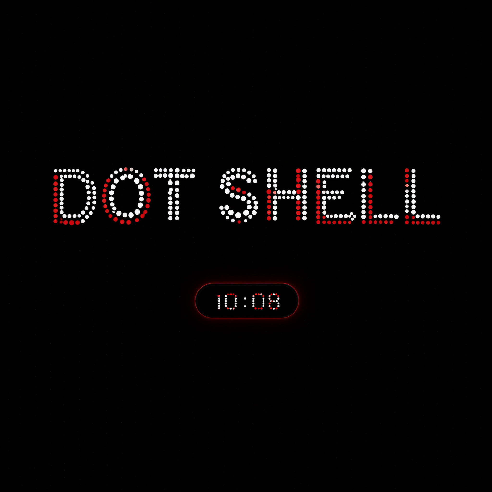

# DOT SHELL

**Nothing-шелл для Windows: «остров» сверху монитора, всё в точках, тема собирается сама из обоев.**

[](../../releases/latest)
[](#скачать-и-установить)
[](#собрать-из-исходников)
[](LICENSE)
[](#честно-о-том-кто-это-написал)

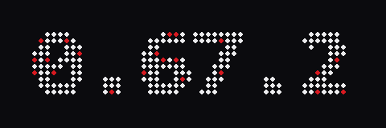

[**⬇ Скачать**](../../releases/latest) · [**🐛 Идеи и баги**](../../issues) · [**📜 История версий**](CHANGELOG.md) · [**🗺 План**](ROADMAP.md)

</div>

---

## Что это

Капсула сверху экрана, которая заменяет то, ради чего обычно лезут в трей: текущий трек,
историю буфера, заметки и задачи, таймер, громкость, чат с локальным ИИ. Всё нарисовано
**точечной матрицей** — часы, текст, обложки, эквалайзер, даже циферблат таймера — одним
движком, поэтому выглядит как одно целое.

Акцентный цвет **сам подтягивается из обоев**, а не выбирается в настройках. Если стоит
Wallpaper Engine — берётся из превью текущих обоев (и шелл знает их название). Мимо
острова клики проходят насквозь: он не мешает работать, пока сам не понадобится.

<div align="center">

| Остров | Плеер |
|---|---|
| 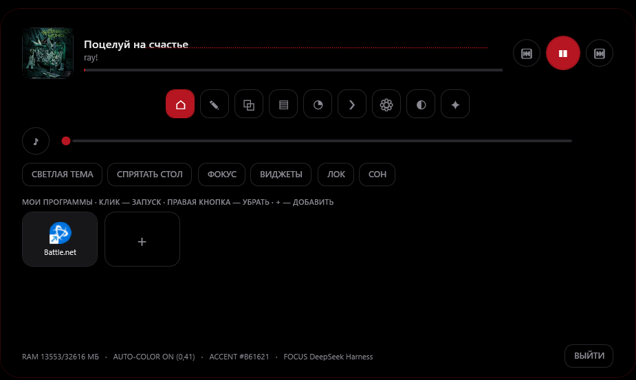 | 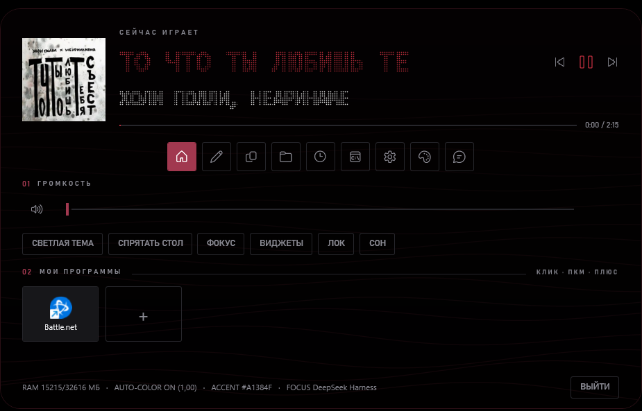 |
| **Окно настроек** | **Заметки, задачи и таймер** |
| 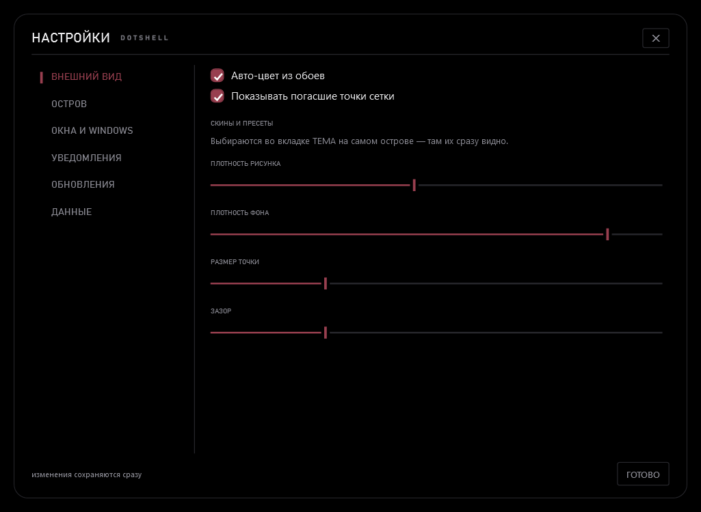 | 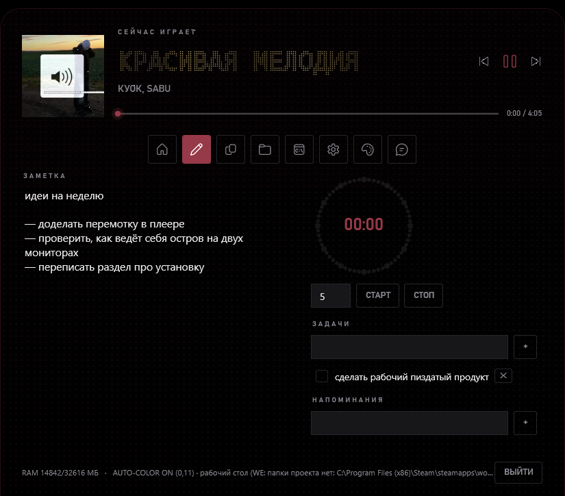 |
| **Уведомление в капсуле** | **Поиск: программы и файлы** |
|  |  |
| **Плеер по размеру: полоса** | **Плеер: карточка и обложка** |
| 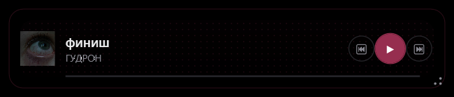 | 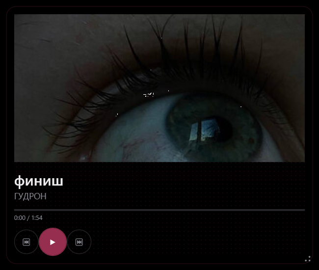 |
| **Плеер-виджет по размеру** | три раскладки: полоса, карточка, обложка во весь виджет. Размер решает, что показывать, а не сколько элементов спрятать |
| **Док слева** | закреплённые программы у левой кромки, точка «запущено», клик-запуск |
| **Центр управления** | выезжает справа: системная громкость, переключатели, питание |
| **Кастомизация формы** | радиус и высота капсулы, отступ от кромки, скорость и кривая анимаций, форма точки (круг/квадрат/ромб/штрих), шахматная сетка |
| **Панель-обзор** | **Погода в панели** |
| 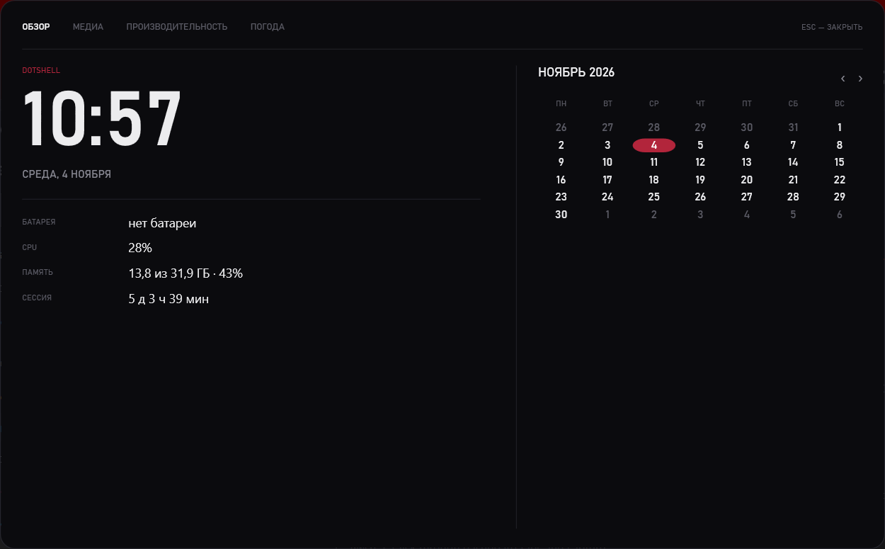 | 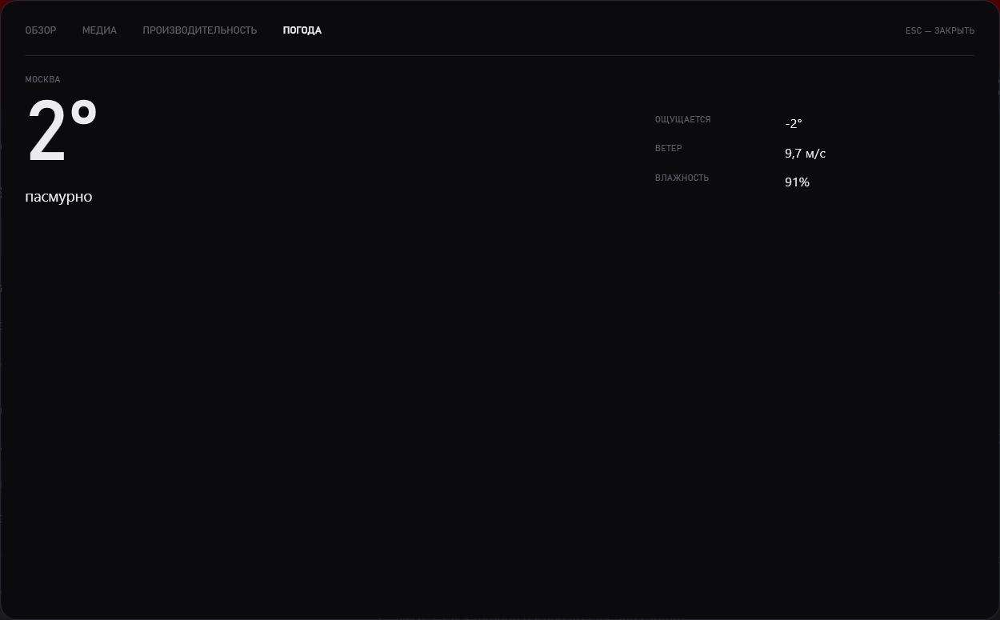 |
| **Панель-обзор** | выезжает сверху: часы, календарь месяца, медиа, CPU и память, погода. Открывается из трея или `--dashboard` |
| **Режим «не мешать»** | **Иконки стола в монохроме** |
| 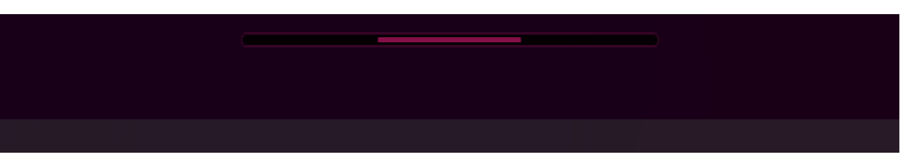 |  |

</div>

## Два архива: island и full

Один и тот же `DotShell.exe`, разница — режим оформления.

| Архив | Что делает |
|---|---|
| **island** | только остров. Систему не трогает вообще |
| **full** | остров **плюс** оформление Windows: тёмные заголовки окон всех программ |

Режим живёт в настройках (`systemStyleFull`), переключается галочкой в настройках или
флагом `--style=full` / `--style=island`. Всё обратимо: снял галочку — заголовки вернулись
как были, ни один системный файл не патчится.

## Что нового в 0.6x

| Версия | Что появилось |
|---|---|
| 0.67 | уведомление растёт из юнита: капсула сжимается до него, юнит «читает» текст, буквы проступают по краю окна |
| 0.64 | трей переписан на `Shell_NotifyIcon`, без WinForms; меню — своё окно |
| 0.63 | умный поиск находит **файлы**, а не только программы |
| 0.62 | своё окно уведомлений вместо системных тостов |
| 0.61 | под иконкой программы видно: точка — запущена, полоска — окно активно |
| 0.60 | smoke-тест сборки и вес: exe 75.4 → 69.9 МБ |
| 0.59 | иконки рабочего стола в монохром, с откатом |
| 0.50–0.57 | окно настроек с категориями, режим «не мешать», выбор устройства эквалайзера, скины вкладок, тема в настройках и виджетах, терминал |

<div align="center">

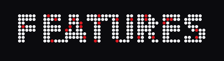

</div>

## Что уже работает

**Остров**

| | |
|---|---|
| Капсула с раскрытием | свёрнута — часы, трек, CPU; раскрыта — плеер, вкладки, панель программ |
| Плеер | Spotify, Яндекс.Музыка, VLC — всё, что отдаёт системные медиа-клавиши: обложка, прогресс, перемотка |
| **Dotify** | работает без интеграции: Tauri-плеер отдаёт метаданные в SMTC, остров и виджет видят трек, обложку и перемотку |
| Название и исполнитель точками | с выбором раскладки: обложка-герой, точечная матрица, компактная строка |
| Буфер обмена | история за сеанс, нечёткий поиск, вставка обратно в то окно, где ты работал |
| Заметки + задачи + таймер | одна вкладка: заметка без рамки, список задач с вычёркиванием, точечный циферблат с бегущей «головой» |
| Напоминания фразой | «таблетки каждый день в 23:00», «через 20 минут чай», «в 18:30 созвон» |
| **Уведомления в капсуле** | капсула сжимается к юниту, юнит водит взглядом по строке, текст проступает по краю раскрывающегося окна. Карточка в углу осталась запасным путём |
| **Режим «не мешать»** | на переднем плане чужое развёрнутое окно — остров сжимается в полоску с акцентной линией, наведение разворачивает |
| Эквалайзер-сталактиты | настоящий спектр из системного звука (WASAPI loopback); в настройках можно выбрать устройство вывода — если музыка играет не на «по умолчанию», иначе спектр видел тишину |
| Чат с ИИ | локально через [Ollama](https://ollama.com): без ключей, без интернета; модель скачивается одной кнопкой |
| Док за кромкой экрана | утащил за верх — снаружи только эквалайзер и акцентная «ручка»; наведение вытаскивает остров обратно |
| Самообновление | скачать новый exe, **проверить** его версию и подменить себя при перезапуске; `.old` остаётся как точка отката |

**Рабочий стол и система**

| | |
|---|---|
| **Окно настроек** | шесть категорий: внешний вид, остров, окна и Windows, уведомления, обновления, данные. В конфигах руками править не нужно |
| **Монохромные иконки стола** | ярлыки перекрашиваются в акцент с сохранением силуэта; оригиналы запоминаются, кнопка возврата на месте |
| **Умный поиск** | `Ctrl+Shift+L`: программы и **файлы** (рабочий стол, документы, загрузки), нечёткий поиск, свежие выше |
| Группы программ | плитки-группы в стиле Nothing: ярлык можно перетащить мышью с рабочего стола или из проводника прямо в группу |
| Виджеты | часы, эквалайзер, плеер, система, юниты, **курс доллара и юаня с графиком**, аудио-роутер, поиск настроек, зашлакованность, дубликаты, светофор обновлений, карта окон — ставятся **перетаскиванием** из витрины |
| Аудио-роутер | **приложение → устройство вывода**: Discord в наушники, игра в колонки, браузер в HDMI |
| Свои программы | плитки на главной вместо ярлыков на столе; поиск по меню «Пуск» |
| Оформление Windows | тёмные заголовки **всех** окон (Win32, проводник, старые программы) — режим full |
| Папки вкладкой | в Windows 11 22H2+ папка открывается вкладкой в уже открытом проводнике, а не новым окном |
| Фокус-шторки | все мониторы, кроме активного, под тёмной вуалью; клики проходят сквозь |
| Мелочи | скрыть иконки стола, тёмная тема Windows, лок, сон — с острова |
| Подсказки хоткеев | зажал Ctrl/Alt/Win — таблица шорткатов именно активной программы |

**Внешний вид**

| | |
|---|---|
| Авто-цвет из обоев | доминирующий цвет + плавные перетекания, 8 ручных пресетов |
| Рисунок острова | точечное поле, волны, топо, лучи, аврора, сетка — процедурные, в цвете акцента; рисунок общий для острова, окна настроек и виджетов |
| Размер точки и зазор | ползунки в настройках, влияют на все точечные контролы сразу |
| Тёмное меню везде | контекстные меню острова, виджетов, групп и трея — своя тёмная геометрия, не системная |
| Скрытие в фуллскрине | игры и видео не трогает |

Полный список с деталями — в [CHANGELOG.md](CHANGELOG.md). План развития —
в [ROADMAP.md](ROADMAP.md), задачи по этапам — в [Issue #1](../../issues/1).

<div align="center">

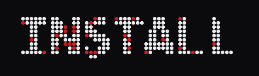

</div>

## Скачать и установить

**island — только остров:**

Скачай с [последнего релиза](../../releases/latest) архив `DotShell-…-island-win-x64.zip`,
распакуй и запусти `install.bat`.

**full — остров + оформление Windows:**

Тот же релиз, архив `DotShell-…-full-win-x64.zip`, запусти `install-full.bat`.

Оба установщика копируют программу в `%LOCALAPPDATA%\Programs\DotShell`, создают ярлык
в «Пуске», включают автозапуск и сразу запускают остров.

**Просто попробовать.** Запусти `DotShell.exe` напрямую — программа портативная, весь
.NET уже внутри файла.

> **SmartScreen:** Windows скажет «Система защитила ваш компьютер» — это обычная
> реакция на программу без платной подписи. «Подробнее» → «Выполнить в любом случае».

<div align="center">


</div>

## Для чата с ИИ нужна Ollama

Чат в острове работает **локально**: модель считает твой компьютер, без ключей и без
интернета. Но саму программу для этого нужно поставить один раз — это единственная
часть, которая ставится отдельно.

1. Скачать и установить [Ollama](https://ollama.com/download).
2. Во вкладке **ЧАТ** нажать **СКАЧАТЬ** — остров скачает рекомендованную модель
   (около 1.4 ГБ, один раз).
3. Дальше всё работает офлайн.

Если Ollama не установлена, вкладка ЧАТ покажет памятку с кнопкой на сайт. Всё
остальное в острове работает и без неё.

<div align="center">

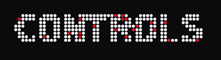

</div>

## Управление

| Действие | Как |
|---|---|
| Раскрыть / свернуть остров | клик по нему, `Ctrl+Shift+Space` или левый клик по иконке в трее |
| Утопить за кромку | перетащить мышью за верхний край: снаружи останутся эквалайзер и «ручка»; наведение — выплывает, клик — раскрывается |
| Буфер обмена | `Ctrl+Shift+V`, двойной клик по записи вставит её в твоё окно |
| Лаунчер (поиск программ и файлов) | `Ctrl+Shift+L` |
| Громкость | колесо мыши над свёрнутой капсулой или ползунок на главной |
| Панель-обзор | трей → «Обзор» или `DotShell.exe --dashboard`; Esc закрывает |
| Настройки | вкладка СИСТЕМА, меню трея → «Настройки…» или `--settings` |
| Виджеты | кнопка ВИДЖЕТЫ на главной или трей → «Витрина виджетов»: карточку можно перетащить прямо на стол |
| Задачи | вкладка ЗАМЕТКИ → поле «＋» или Enter; квадрат — вычеркнуть, крестик — убрать |
| Таймер | вкладка ЗАМЕТКИ → минуты → СТАРТ; круг показывает прогресс, «голова» едет по времени |
| Подсказки хоткеев | зажать Ctrl / Alt / Win (включается в настройках) |
| Открыть сразу на вкладке | `DotShell.exe --tab=notes`, `--tab=chat`, `--gallery`, `--keys`, `--launcher` |
| Режим оформления | `DotShell.exe --style=full` или `--style=island` |

<div align="center">

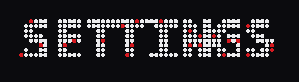

</div>

## Настройка

Всё пользовательское живёт в `%LOCALAPPDATA%\DotShell\`:

| Файл | Что в нём |
|---|---|
| `settings.json` | акцент, авто-цвет, размер точки и зазор, прозрачность, рисунок, раскладка плеера, автозапуск, устройство эквалайзера, город погоды, режим оформления, интервал проверки обновлений |
| `notes.md` | заметки — обычный markdown |
| `tasks.json` | список задач вкладки «Заметки» |
| `widgets.json`, `pinned.json` | какие виджеты стоят и куда их оттащили; плитки и группы программ |
| `desktop-icons\` | монохромные иконки и карта оригиналов (`originals.json`) — для кнопки «Вернуть иконки» |
| `crash.log` | ошибки (если остров пропал — сначала сюда) |

Большинство настроек есть в окне настроек — в JSON лезть не обязательно.
Тема — один JSON-файл, пример: [themes/example-nothing-red.json](themes/example-nothing-red.json),
генератор темы из картинки: `tools/theme_from_image.py`.

## Проверка сборки

```powershell
pwsh -File scripts/smoke.ps1
```

Скрипт сверяет версию из `Directory.Build.props` с той, что сообщает сам exe, собирает
проект, гоняет самопроверку (`--selftest`: настройки, акцент, мониторы, ярлыки, апдейтер),
ищет в логе `FATAL` после запуска и возвращает код 0/1. Пока запускается руками —
в GitHub Actions не подключён.

<div align="center">

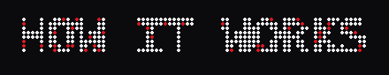

</div>

## Как это устроено

```
├── src/
│   ├── DotShell.Core/          ← ядро БЕЗ UI: настройки, шина темы, DotGrid,
│   │                              буфер, SMTC, хоткеи, Win32, трей (Shell_NotifyIcon),
│   │                              задачи, файловый индекс, тёмные заголовки окон
│   ├── DotShell.Island.Wpf/    ← остров на WPF (активная версия)
│   └── DotShell.Island/        ← остров на WinUI 3 (архивный, в сборке не участвует)
├── release/                    ← install.bat / install-full.bat / uninstall.bat
├── scripts/smoke.ps1           ← проверка сборки
├── themes/                     ← тема = один JSON
├── tools/                      ← генератор темы и иконки (Python)
└── docs/                       ← FEASIBILITY, TROUBLESHOOTING
```

Ключевые швы: **`ShellServices`** собирает сервисы, **`ThemeBus`** разносит акцент и размеры
точек по подписчикам, **`DotGrid`** рисует всё точечное (часы, текст, обложки, EQ,
циферблат), **`IslandViewModel`** хранит состояние острова, а XAML к нему только привязан.
Общие стили меню лежат в **`MenuStyles.xaml`** и подключаются на уровне приложения.

**Почему WPF, а не WinUI 3:** WinUI 3 не собрать без Visual Studio, а WPF входит в обычный
.NET SDK — программа собирается одной командой где угодно. Для оверлея WPF подходит не хуже:
`AllowsTransparency` даёт попиксельную прозрачность, клики мимо острова проходят сквозь него.

## Собрать из исходников

Visual Studio **не нужна**, достаточно бесплатного .NET SDK 8:

```powershell
winget install Microsoft.DotNet.SDK.8
```

```bat
build.bat            :: Debug-сборка для разработки
build.bat publish    :: Release одним файлом → publish\DotShell.exe
build.bat installer  :: publish + установщик (нужен Inno Setup 6)
```

В IDE: открыть `DotShell.sln`, startup-проект **DotShell.Island.Wpf**, платформа **x64**, F5.
Если не собирается — [docs/TROUBLESHOOTING.md](docs/TROUBLESHOOTING.md).

<div align="center">

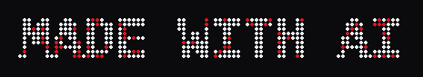

</div>

## Честно о том, кто это написал

**Код написан не мной, а искусственным интеллектом — [Qwen](https://chat.qwen.ai/) и
[DeepSeek](https://deepseek.com/).** Qwen сделал основу: первый остров, ядро, дизайн,
релизы 0.1–0.5. С версии 0.6.0 проект ведёт DeepSeek (среда DeepSeek Harness): аудио-роутер,
адаптивный остров, рестайл, менеджер виджетов, заметки с задачами, таймер-циферблат,
оформление Windows, окно настроек, уведомления в капсуле, трей на Win32.

Моя роль — владелец: придумал, что хочу получить, формулирую требования, тестирую сборки
на своём компьютере и направляю развитие. Поэтому **обратная связь особенно нужна**:
я один человек с одним монитором, а проект претендует на замену куска системы.

<div align="center">

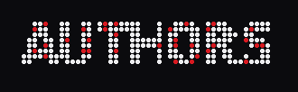

</div>

## Обратная связь

- 🐛 **Баг** — [Issues → Bug report](../../issues/new/choose): что делал, что ожидал,
  что случилось (+ `crash.log`, если есть);
- 💡 **Идея или совет** — [Issues → Idea](../../issues/new/choose);
- 🎨 Особенно интересны замечания по стилю: где получилось похоже на Nothing/CMF,
  а где режет глаз.

<div align="center">

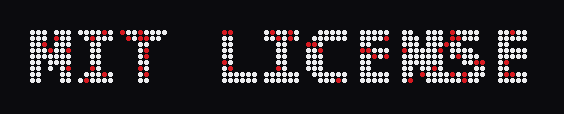

</div>

## Лицензия и благодарности

- Код — [MIT](LICENSE). © chmoshnik187, Qwen и DeepSeek (ИИ-соавторы).
- Баннеры в этом README — точечная матрица, нарисованная нашим же генератором: `python tools/make_banner.py "ТЕКСТ" out.png`.
- Визуальный язык вдохновлён **Nothing OS / CMF by Nothing** (проект не аффилирован
  с Nothing Technology; фирменный шрифт NDot не используется — точки рисует свой движок).
- Медиа — через системный SMTC Windows; системный EQ планируется поверх
  [Equalizer APO](https://equalizerapo.com/); живые обои — вероятно поверх
  [Lively Wallpaper](https://github.com/rocktimsaikia/lively).
- Идея «протекания» обоев и WorkerW-трюк разобраны в сообществе Lively Wallpaper.

---

<div align="center">

*Собрано человеком, [Qwen](https://chat.qwen.ai) и [DeepSeek](https://deepseek.com) · [v0.75.0](../../releases/tag/v0.75.0) · остров, который уже живёт на экране*

</div>
